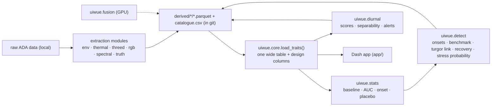

# How UiWUE works: complete technical reference

This document explains the whole repository: every extraction step, every statistical test, every
model, every result table and every app page. Each method is written so that you can explain it
out loud: what it does in plain words, exactly how it is computed, its parameters, why it was
chosen, what to watch out for, and where the code is.

- **Data:** ADA 2025 sugar beet water-deficit dataset [DATA], described in the paper [ADA].
  "[ADA §III-A]" points to a section of that paper.
- **State described:** branch `main`, 2026-11-15. The result numbers are read from the tables in
  `derived/` (the detection run finished 2026-11-15 02:05 UTC).
- **Day numbering:** day 0 = 3 Sep 2025, the day irrigation of beds W2 and W3 stopped.

### How each method is described

| Field | Content |
|---|---|
| **Plain words** | one or two sentences you can say to a non-specialist |
| **Exactly** | the computation, step by step, with formulas |
| **Parameters** | every constant and its value |
| **Why** | the reason for this choice |
| **Watch out** | assumptions, limits and traps |
| **Code** | file and function |

---

## Contents

1. [The experiment and the paper](#1-the-experiment-and-the-paper)
2. [Facts about the data found while building UiWUE](#2-facts-about-the-data-found-while-building-uiwue)
3. [Architecture and the shared contract](#3-architecture-and-the-shared-contract)
4. [Extraction: from raw files to trait tables](#4-extraction-from-raw-files-to-trait-tables)
5. [Shared statistics (used by every analysis)](#5-shared-statistics-used-by-every-analysis)
6. [Detection analyses](#6-detection-analyses)
7. [Daily rhythm and irrigation statistics](#7-daily-rhythm-and-irrigation-statistics)
8. [3D validation statistics (E0a–E5)](#8-3d-validation-statistics-e0ae5)
9. [Machine-learning models](#9-machine-learning-models)
10. [Results](#10-results)
11. [The app, page by page](#11-the-app-page-by-page)
12. [Tests and reproducibility](#12-tests-and-reproducibility)
13. [UiWUE against the paper, point by point](#13-uiwue-against-the-paper-point-by-point)
14. [Conventions that differ between modules](#14-conventions-that-differ-between-modules)
15. [Limits](#15-limits)
16. [References](#16-references)

---

## 1. The experiment and the paper

### 1.1 Design

| Item | Value | Source |
|---|---|---|
| Crop | sugar beet, *Beta vulgaris* ssp. *vulgaris* var. *altissima*, cultivar CALLEDIA KWS Öko | [ADA §II-A] |
| Site | DFKI "AI Market Garden" greenhouse, Bohmte, Lower Saxony, 2025 | [ADA §II-A] |
| Plants | 216 pots in three beds (2 m × 1 m), 72 per bed, checkerboard grid rows A–R | [ADA §II-A, Fig. 2] |
| Treatment | W1 watered control; W2 and W3 water deficit | [ADA §II-A] |
| Seeded | 4 Aug 2025 | [ADA §II-A] |
| Watering | 11:00 and 19:00 daily, 8 min per bed | protocol sheet in [DATA] |
| Irrigation off | 3 Sep 2025 after the 11:00 watering (about BBCH 14) | [ADA §II-A] |
| Re-watered | 15 Sep 2025, 18:35 (after the 18 h imaging run); schedule resumes 16 Sep | protocol sheet |
| End | 22 Sep 2025; all but 3 plants recovered | [ADA §II-A] |

### 1.2 Sensors

A gantry robot (FarmBot Genesis v1.6 with a camera platform, Intel NUC, ROS 2) imaged every plant
five times a day, at 06, 09, 12, 15 and 18 h, from 12 Aug to 22 Sep [ADA §II-B].

| Modality | Device | Per plant and run | Sub-dataset DOI |
|---|---|---|---|
| Thermal | FLIR A70, 640 × 480 px, °C, accuracy ±2 °C | 5 frames | 10.26249/FK2/ASL0BV |
| Depth | pmd Pico Flexx time-of-flight, 224 × 171 px, depth + NIR intensity | 15 frames | 10.26249/FK2/SMHP1Y |
| RGB | Logitech C920 webcam, 1920 × 1080 JPEG | 15 frames | 10.26249/FK2/FGLG94 |
| Hyperspectral | Resonon Pika L push-broom, 300 bands | 1 cube (raw uint8 JP2 + JSON) | 10.26249/FK2/PK9YDR |
| Air | 2 × BME280 (temperature, humidity, pressure), every 2 min | n/a | 10.26249/FK2/C0HOBN |
| Light | Driesen PAR sensor, every 15 min, raw mV | n/a | same |
| Turgor | 21 AgriHouse Leaf Sensor Rev4 clips, every 2 min | n/a | same |

Sources: [ADA §II-C, §II-E, Table I]; DOIs from the dataset record as noted in
`docs/Sam-Analysis-Notes.md`. The paper gives the Pika L range as 400–1000 nm in 2.7 nm steps; the
cube files cover about 384–1025 nm in 300 bands. About 6.4 % of planned camera runs are missing,
and failed runs were repeated within about an hour [ADA §II-E].

### 1.3 Ground truth

| Measurement | Details | Source |
|---|---|---|
| Leaf clips | leaf thickness as a turgor proxy; 9 clips in a Z pattern in W2, 9 in W3, 3 down the centre of W1. The reading **rises as turgor falls** | [ADA §II-F2]; [Seelig2012] |
| Relative water content | destructive, W3 only, days 1, 3, 5, 6, 7, 8, 11, 12; 8 plants per day; youngest fully developed leaf; 3 h rehydration; dried 3 h at 70 °C; RWC = (fresh − dry)/(turgid − dry) × 100 | [ADA §II-F1]; [Barrs1968] |
| Notes | BBCH stages and symptom notes on 2, 6, 8, 10, 12, 15 Sep; pests and mildew noted | [ADA §II-F3] |
| Soil sensors | deployed, unusable | [ADA §V] |

### 1.4 What the paper analysed

| Analysis | Method in the paper | Result in the paper |
|---|---|---|
| Scope | W1 vs W2, 5 plants per bed (A2, A8, J5, R1, R7), 15 h run only, 3–14 Sep | [ADA §III] |
| Height | ExG > 5 segmentation [Woebbecke1995]; height = 75th percentile of vegetation points; LMM `height ~ day × treatment + (1 \| plant)` | control +0.00430 m/day (p = 4.61 × 10⁻¹⁴); interaction −0.01308 m/day (p = 3.45 × 10⁻⁵⁹) [ADA §III-A] |
| Indices | flat-field reflectance; plant mask from a model trained on 234 masks; Savitzky–Golay smoothing (31 bands, order 3); OLS on bed-date means | interactions: NDVI −0.0189/day, CI red edge −0.0098/day, SIPI +0.0143/day [ADA §III-B] |
| Leaf temperature | coolest 50 % of thermal pixels minus median air temperature | interaction +0.596 °C/day, p = 0.030 [ADA §III-B] |
| Turgor link | Spearman of bed-mean signals against W2 bed-mean turgor over days | NDVI ρ = −0.930; CI red edge −0.860; SIPI 0.944; leaf − air 0.853 [ADA §III-C] |
| Onset day | not given; height plateaus "several days after" the cutoff | [ADA §III-A, Fig. 4] |
| Status | "not ... a benchmark in the sense of a full ML pipeline"; no splits provided | [ADA §IV] |

---

## 2. Facts about the data found while building UiWUE

None of these is in the paper. Each was checked on the data and each changed a module.

| Fact | Evidence | Consequence |
|---|---|---|
| Air sensor 2 is at the W1 end, sensor 1 at the W3 end; W2 has no sensor | Sensor Guide sheet; readings | W1-end air is used for every bed (`env_air_t`) |
| The W3-end sensor reads about 2.9 °C warmer at 15 h (1–16 Sep); VPD at W3 is 0.15–0.70 kPa higher after the cutoff | sensor comparison | leaf minus control-bed leaf is preferred to leaf minus air |
| Doors near the plants were closed on 2 Sep; daytime climate went from 24 °C / 60–68 % RH to 27–33 °C / 36–48 % RH | protocol "Raw Protocol" sheet | baselines end on 2 Sep; a common date effect is expected in all beds |
| The 15 depth/RGB frames of a run are a 3 × 5 grid of robot positions 0.1 m apart (robot x = 0.78, 0.88, 0.98 m), in three sweeps about 40 s apart | robot poses | 3D traits use only frames that see the whole plant |
| ADA's robot-to-depth rotation (`rotz(+90°)`) maps robot x to depth +y; the data say −y | cross-column disagreement falls from 14–52 mm to 5–11 mm | corrected matrix in `calib.R_ROBOT_TO_DEPTH` |
| The soil is 0.45–0.52 m below the depth camera (median 0.487 m), not 0.60 m | fitted soil planes | heights are measured from a fitted soil plane |
| Depth noise on soil σ ≈ 4.0 mm per frame (3.6 mm after a 3 × 3 median) | frame differences, 168 pairs | sets the QC spread rule and the E1 noise floor |
| About 27 % of ToF points have no RGB pixel | projection | dark or uncoloured points use a height-only vegetation rule |
| The PAR logger clock is CEST, not UTC | a logged sensor move appears at 15:32–15:47 | PAR is localised to Europe/Berlin |
| W3 clips show no midday dip, even before the cutoff | clip traces | W3 clip daily amplitude is not used |
| Clip plants and RWC plants do not overlap | sheets | two separate ground truths |
| Leaf inclination rises by about 20 % in both beds over 2–5 Sep | rig, plane, normals, mask and raw ToF all ruled out | a real canopy change at the door closure; between-bed contrasts stay valid |

---

## 3. Architecture and the shared contract

### 3.1 Data flow



| Layer | Rule |
|---|---|
| Raw data | local only; each owner downloads only their modality |
| Extraction | one module per modality; writes one run-level table on the contract keys |
| Core (`uiwue.core`) | the only code every module imports: keys, dates, I/O, merge, validator |
| Statistics (`uiwue.stats`) | the only implementation of baseline, AUC, onset and placebo |
| Analysis | reads the merged table; writes result tables to `derived/` |
| App | reads `derived/` only; never reads raw images (3D clouds come from a cache) |

### 3.2 Keys

Every run-level table has **one row per `bed`, `plant`, `date`, `hour`**:

| Key | Type | Meaning |
|---|---|---|
| `bed` | str | `W1`, `W2`, `W3` |
| `plant` | str | grid position, e.g. `J5`; `core.all_plants()` lists the 72 per bed (rows A–R, alternating columns A2 A4 A6 A8 / B1 B3 B5 B7 …) |
| `date` | date | local date of the run |
| `hour` | int | the **scheduled slot**: 6, 9, 12, 15 or 18 |

**Slot mapping** (`core.slot_for_hour`): a run folder's hour maps to the nearest slot if at most
1 h away, else it is dropped. If two folders map to one slot, the scheduled folder wins if it has
data, otherwise the folder with the most frames. Each module keeps the folder it used as
`<prefix>capture_hour`. **Why:** re-runs sit in different folders per camera (thermal at 16 h,
hyperspectral at 15 h); folder hours would not join across sensors.

### 3.3 Columns and catalogue

- Every non-key column has a module prefix: `thermal_`, `depth_`, `rgb_`, `hsi_`, `env_`,
  `truth_`, `detect_`, `diurnal_`.
- Frame spread: `<col>_mad`. QC: `<prefix>qc_<flag>`, `<prefix>qc_pass`. Bookkeeping:
  `_capture_hour`, `_timestamp_utc`, `_n_frames_ok`.
- **Design columns are never stored.** `core.add_design()` adds them on load:
  `treatment` = control if bed W1 else deficit; `days_since_cutoff` = date − 3 Sep;
  `phase` = "before cutoff" (day < 0), "stress" (0–12), "re-watered" (> 12).
- **Catalogue** `derived/<module>/catalogue.csv`: `column, label, unit, direction, description`.
  `direction` = +1 if the trait rises under deficit, −1 if it falls, 0 if not a stress trait.
  The statistics use it to orient every AUC; the app uses labels and units.

### 3.4 Merge: `core.load_traits()`

1. Outer-join all `*/traits_runs.parquet` on the keys (these define which runs exist).
2. Left-join every other `*_runs.parquet` (environment, turgor, scores) onto those runs.
3. Add design columns. Cached per process (`lru_cache`); `clear_caches()` resets it.

### 3.5 Validator: `python -m uiwue.core.validate`

Checks per table: size < 20 MB; no duplicate keys; bed in W1–W3; plant matches `[A-R][1-8]`;
hour in the five slots; dates parse; no stored design columns; every column prefixed; catalogue
present with the right columns; directions in {−1, 0, 1}; every numeric trait column (not MAD,
not QC, not bookkeeping) has a catalogue row. `tests/test_contract.py` runs it on every table.

### 3.6 Windows, plant sets and fixed choices (`src/uiwue/core/__init__.py`)

| Constant | Value | Why |
|---|---|---|
| `CUTOFF` | 3 Sep 2025 (day 0) | last watering of W2/W3 at 11:00 |
| `REWATER` | 15 Sep 2025 | re-watered at 18:35, after the 18 h run, so day 12 is still stress |
| `DATES` | 24 Aug–22 Sep | earlier dates are seedlings |
| `PLACEBO` | 24–29 Aug | healthy days, not used for the baseline |
| `BASELINE` | 30 Aug–2 Sep | the plant's own healthy reference, just before the cutoff |
| Stress window | days 0–12 | 3–15 Sep |
| Daily value | median of the 12 h and 15 h runs passing QC | midday is when transpiration differences show |
| `DEV_CONTROLS` | W1 A2, J5, R7, B3 | controls used to tune thresholds on W2 |
| `CONFIRM_CONTROLS` | W1 A8, R1, Q6 | controls kept for the W3 check |
| Core plants | 10 paper plants + 21 clip plants = 29 (7 controls) | parity with the paper, per-plant turgor |
| Extended plants | W1 B5 E4 G6 K6, W2 B3 G2 I6 Q6 (hand-labelled); thermal adds W1 F5, N3 | more controls, QC check |

### 3.7 Rules for valid results (`plan/Master-Plan.md` §6.7)

1. **The plant is the unit.** Models are validated leave-one-plant-out; runs are never split at
   random (runs of one plant on nearby days are strongly correlated, so a random split leaks).
2. **No date, bed, hour or grid position as model input** (a model could learn "W2 after 3 Sep").
3. **A size-only baseline** (`depth_projected_area`) sits beside every detection result.
   Stressed plants stop growing, so size alone separates groups after a few days.
4. **The placebo runs before any result is reported** (§5.6).
5. **Tune on W2, confirm on W3.** Thresholds and settings are picked on W2 with
   `DEV_CONTROLS`, then applied unchanged to W3 with the other controls.
6. **All normalisation and tuning happens inside the training fold.**

---

## 4. Extraction: from raw files to trait tables

| Table | Rows | Plants | Dates |
|---|---|---|---|
| `derived/env/env_runs` | 32,400 | 216 | 24 Aug–22 Sep |
| `derived/thermal/traits_runs` | 5,402 | 39 | 24 Aug–22 Sep |
| `derived/threed/traits_runs` | 3,645 | 28 (W1 11, W2 17) | 24 Aug–19 Sep |
| `derived/rgb/traits_runs` | 2,601 | 18 (W1 9, W2 9) | 24 Aug–22 Sep |
| `derived/truth/turgor_runs` | 2,043 | 21 | 2–22 Sep |
| `derived/truth/plants` | 216 | 216 | n/a |
| `derived/truth/rwc_leaves` | 63 | 63 | 4–15 Sep |
| `derived/spectral/*` | not on `main` (code and tests only) | | |

### 4.1 Environment (`src/uiwue/env/__init__.py`)

One row per plant (all 216) and scheduled run, so any run can be joined to its conditions.

| Column | Exactly | Unit |
|---|---|---|
| `env_timestamp_utc` | nominal scan time = slot hour + bed offset (W1 +5, W2 +15, W3 +25 min), local → UTC (`nominal_times`) | UTC |
| `env_air_t`, `env_rh` | W1-end BME280, centred 10-min rolling median, nearest reading within 10 min (`at_times`), else missing | °C, % |
| `env_air_t_w3`, `env_rh_w3`, `env_vpd_w3` | same from the W3-end sensor | |
| `env_vpd` | Tetens [Tetens1930]: `0.6108 · exp(17.27·T/(T + 237.3)) · (1 − RH/100)` | kPa |
| `env_par_mv` | raw PAR logger, nearest reading within 20 min | mV |
| `env_global_rad` | DWD Belm 10-min global radiation [DWD], `GS_10 (J/cm²) × 10⁴ / 600`, centred 30-min mean | W/m² |
| `env_sunshine` | DWD sunshine `SD_10 (h per 10 min) × 6`, trailing 60-min mean = share of the last hour with sun | 0–1 |
| `env_light_wm2` | `env_par_mv × scale`; `scale = 1/c` where `mV = c · W/m²` is fitted through the origin on hourly daytime means (outside radiation > 20 W/m²). Hourly r = 0.92; 1 mV ≈ 110 W/m² | W/m² |
| `env_sky` | `dark` if global radiation < 20 W/m²; `sunny` if sunshine ≥ 0.5; else `cloudy` (text, not in catalogue) | label |
| `env_vpd_since_water` | trapezoid integral of VPD since the bed's last watering: `∫ VPD dt` | kPa·h |
| `env_hours_since_water` | hours since the last watering | h |

Watering times (`watering_times`): 11:00 and 19:00 daily; for W2/W3 none between 3 Sep 11:00 and
16 Sep, plus the manual watering at 15 Sep 18:35. Sky labels per bed-run: 06 h always dark (90
of 90); 09 h 32 sunny, 55 cloudy, 3 dark; 12 h 37 / 53 / 0; 15 h 35 / 55 / 0; 18 h 36 / 47 / 7.

### 4.2 Thermal (`src/uiwue/thermal/__init__.py`)

**Plain words:** take the coolest half of each thermal image as the leaves, and compare its
temperature with the air and with the watered bed in the same run.

**Per frame** (`frame_stats`):

| Column | Exactly |
|---|---|
| `thermal_leaf_t` | `leaf_t(img)` = median of pixels ≤ the image's 50th percentile (the **authors' rule** [ADA §III-B]) |
| `thermal_leaf_t_p10` | 10th percentile of the image (stricter leaf estimate) |
| `thermal_bg_t` | 75th percentile (pots and soil; direction 0) |
| `thermal_leaf_t_r160`, `_r80` | `leaf_t` on the image averaged in 4 × 4 or 8 × 8 blocks = a 160 × 120 or 80 × 60 camera (`block_mean`) |

**Per run:** median over frames; `thermal_leaf_t_mad` = median |frame − run|;
`thermal_timestamp_utc` = median frame timestamp from `frames_thermal.csv` (else folder hour +
10 min). QC: `thermal_qc_few_frames` if < 3 frames; `thermal_qc_pass` = not that.

**References:**

- `thermal_leaf_air_dt` = leaf − W1-end air temperature (10-min median) at the run's timestamp,
  for every bed.
  A transpiring leaf is cooler than air; with stomata closed it warms towards or above air. This
  is the basis of the crop water stress index [Jackson1981] and the paper's signal.
- `thermal_leaf_ref_dt` = leaf − median leaf temperature of the W1 plants in the **same run**
  (date and slot), using only QC-passing runs, needing ≥ 3 controls; a control plant is compared
  with the other controls (leave-one-out) (`control_reference`). It cancels weather, light and
  the missing W2 air sensor.

**Watch out:** the coolest half includes soil when the canopy is small or wilted; a calibrated
leaf mask from depth (the thermal extrinsic is in `calib.T_DEPTH_TO_FLIR`) would remove that.

### 4.3 RGB (`src/uiwue/rgb/`)

**Plain words:** what a cheap camera sees: how much green is in the middle of the image and how
green it is.

1. Runs are read from the zip archives or folders; folder hours → slots as in §3.2
   (`assign_slots`).
2. Frame 7 (grid centre) is used by default (`pick_frames`).
3. Centre crop: a square of side 0.5 × image height (540 px), so neighbours stay mostly out.
4. Vegetation: `2G − R − B > 5` on 8-bit values (the paper's ExG rule [Woebbecke1995]).
5. Frame flags: `dark` if mean crop brightness < 12; `mask_failed` if < 200 vegetation pixels.

| Column | Exactly | Direction |
|---|---|---|
| `rgb_green_cover` | vegetation pixels / crop pixels | −1 |
| `rgb_exg` | mean of `2g − r − b` on chromatic coordinates `r = R/(R+G+B)` etc., vegetation pixels | −1 |
| `rgb_ngrdi` | mean `(G − R)/(G + R)` [Tucker1979] | −1 |
| `rgb_hue` | circular mean of HSV hue (degrees) of vegetation pixels; yellowing lowers it from about 100° | −1 |
| `rgb_brightness` | mean crop brightness (exposure check) | 0 |

Run value = median over frames that are neither dark nor mask-failed (all frames if none), with
MAD. `rgb_qc_pass` = at least one good frame. **Why 12:** night frames sit near 4, daytime
frames are dim (median about 40 at 12 h) but still segmentable at 20; a threshold of 40 failed
half of the 12 h runs.

### 4.4 3D structure from depth + RGB (`src/uiwue/threed/`)

Full method: `docs/threed/PIPELINE.md`. Per run (`run.process_run`):

**Step 1. Load** (`io`): depth page 0 (metres) and NIR page 1, both rotated 180°; RGB decoded at
half resolution (960 × 540). Runs without pose files (17 runs on 29 Aug and 15 Sep) get
`qc_no_pose` and the nominal grid offsets.

**Step 2. Point cloud** (`cloud.build_cloud`):
- Enclosed invalid regions ≤ 150 px are inpainted from their rim (Telea [Telea2004]); 2.8 % of
  plant points come from filled holes. **Why:** bright young leaf interiors saturate the ToF;
  only rims return depth.
- Masked 3 × 3 median; pixels with < 5 valid neighbours (of 9) are dropped as speckle.
- Valid depth 0.20–0.80 m; pixels > 112 px from the principal point are outside the valid view.
- Each pixel is unprojected along its own undistorted ray (`calib.K_DEPTH`, distortion).
- Colour: each point is projected into the raw RGB with the depth→RGB extrinsic (shifted by the
  robot offset between the RGB and depth captures of that frame) and the RGB distortion. A
  z-buffer (8 px cells, 10 mm tolerance) marks points hidden from the RGB camera as uncoloured.
- Pixel ground area `a_px = z² · a`, where `a` is the per-pixel area factor from the lens model.

**Step 3. Frames in one coordinate system:** `p_common = p_frame + M · p_robot`, with `M` the
**corrected** robot→depth rotation `[[0,−1,0],[−1,0,0],[0,0,1]]`.

**Step 4. Plant centre:** where the frame-7 RGB optical axis meets the reference plane, refined
once to the centroid of vegetation within 4 cm (≥ 20 points; median shift 8.5 mm). In frame k:
`c_k = c_7 − (M·p_robot[k] − M·p_robot[7])`.

**Step 5. Frame selection:** a frame is used when ≥ 98 % of the plant cylinder footprint
(r = 8.5 cm) lies in the valid ToF view and ≥ 95 % in the RGB view. Pose-only rule, independent
of image content. Median 6 frames per run (typical sets 4, 7, 10 in W1; 0, 1, 3, 4, 6, 7, 9, 10
in W2, where the camera is higher).

**Step 6. Soil plane** (`ground.fit_reference`):
- Candidates: non-ExG points within 5 cm of the centre, pooled from all used frames.
- RANSAC [Fischler1981]: 500 three-point hypotheses, inlier distance 5 mm, only planes within
  15° of the camera axis are scored; least-squares refit on the inliers.
- Accept if ≥ 150 inliers per pooled frame, tilt ≤ 15°, and level at the centre within 20 mm
  of the carried reference. Else use the carried reference and set `qc_ref_carried`.
- Carried reference = median of the plant's accepted planes on its first 7 dates (≥ 3 fits),
  stored in `plant_refs.csv`. In the full batch 4,204 runs use their own fit and 1,766 the
  carried one; soil level over a plant's own fits varies by 4.0 mm SD.
- Plane `n·p + d = 0`; plane-local coordinates `(a, b, h)`: in-plane offsets from the centre and
  height above the soil.

**Step 7. Vegetation** (`segment.vegetation_mask`): normal light: `ExG = 2G − R − B > 5` and
`h > 5 mm`. Dark frame (median brightness < 10) or uncoloured point: `h > 15 mm` only.

**Step 8. Isolate the plant** (`segment.isolate_plant_multi`):
- Vegetation within 13 cm of the centre, from all used frames, pooled on a 2.5 mm voxel grid.
- DBSCAN [Ester1996]: eps 8 mm, min 10 points.
- Keep clusters whose nearest point is within 3 cm of the centre; clip to a cylinder r = 8.5 cm
  (half the neighbour spacing); map back to each frame.
- `clipped_fraction` = share of kept points within 5 mm of the cylinder wall.
- **Why one clustering over all frames:** per-frame clustering kept different leaves in
  different frames (height spread up to 28 mm).

**Step 9. Traits per frame** (`traits.frame_traits`; N = plant points; < 10 points → NaN):

| Trait | Formula | Unit |
|---|---|---|
| `height_p50`, `_p75`, `_p95` | percentiles of `h` | mm |
| normals | PCA over ≤ 30 nearest neighbours within 12 mm; normal = eigenvector of the smallest eigenvalue | |
| `inclination_mean`, `_sd` | mean and SD of `θ = arccos|n·N|` (N = plane normal); 0° flat, 90° vertical | ° |
| per-point surface area | `s = a_px · cos φ / max(|n·r̂|, cos 75°)`; φ = angle of the ray to the optical axis, r̂ = ray direction | |
| `leaf_area_est` | `Σ s` | cm² |
| `projected_area` | `Σ clip(s·|n·N|, 0.5·a_px, 2·a_px)`: the footprint on the soil plane, foreshortening removed | cm² |
| `hull_volume` | convex hull of the points plus their projections onto the plane | cm³ |
| `canopy_radius` | 95th percentile of `√(a² + b²)` (capped by the 8.5 cm cylinder) | mm |
| `droop_index` | `height_p50 / height_p95` | ratio |
| `compactness` | `projected_area / area of the 2D convex hull of (a, b)` | ratio |
| `n_points` | number of plant points (how much canopy the camera sees) | count |
| `cyl_*` | height percentiles, projected area and point count of **all** vegetation inside the cylinder, without clustering | |

**Why tilt-corrected area:** the plain `Σ z²/(fx·fy)` is right only for flat leaves facing the
camera; in the synthetic test it under-reads by 4.7 % at 20° and 8.8 % at 35°.

**Step 10. Aggregate and QC** (`qc.aggregate_run`): run value = median over used frames that
found the plant; `_mad` = unscaled MAD; a run needs ≥ 2 good frames.

| Flag | Rule | Blocks `qc_pass` |
|---|---|---|
| `qc_no_plant` | no good frame, or more than half the used frames find no plant | yes |
| `qc_few_points` | median `n_points` < 300, or < 2 good frames | yes |
| `qc_high_spread` | `height_p75_mad` > max(5 mm, 5 % of `height_p75`) | yes |
| `qc_overlap` | median `clipped_fraction` > 0.10 (neighbours' leaves at the wall) | yes |
| `qc_not_centred` | kept centroid > 3 cm from the centre | no |
| `qc_dark` | median brightness of used frames < 10 (height-only rule used) | no |
| `qc_ref_carried` | soil plane taken from the carried reference | no |
| `qc_no_pose` | no robot pose file | no |

**Step 11. Team table** (`python -m uiwue.threed.contract`): `depth_` prefix, slot mapping,
dates from 24 Aug, the four diagnostics `soil_z_mm`, `clipped_fraction`, `centroid_offset_mm`,
`brightness` (direction 0), and a catalogue with directions from the E3 slopes
(`inclination_sd` = 0, below the noise floor).

The batch: 5,970 runs (28 plants, 12 Aug–19 Sep, all slots), 0 errors, 0.48 s per run on one
core, about 3 minutes on 20 workers; 5,970 cached clouds (frame 7, plant-centred, points within
15 cm) for the 3D canopy page.

**Refined depth (optional, `--depth-model`)**: replaces each frame's ToF depth with the
fine-tuned Prompt Depth Anything map (§9.2), resampled to the ToF pixel grid (per pixel: points
projecting into it are z-buffered with 10 mm tolerance and averaged). Pixels without a refined
sample keep the processed ToF. Everything after the depth is unchanged; outputs go to a separate
folder and the CLI refuses to mix them with the contract table.

### 4.5 Hyperspectral (`src/uiwue/spectral/__init__.py`)

Code and tests only; no table on `main` yet.

1. **Read** the raw uint8 cube (`rasterio` on the JP2) and its JSON.
2. **Flat-field correction** (the paper's formula [ADA §II-D2]):
   `C = (R − D) / (W · m − D)`, with dark frame `D` (`black_reference.npy` from [CODE]),
   gray-panel spectrum `W` (from the run's JSON, captured once per plant row per run) and
   `m = 2.0` so the 50 % gray panel maps to C ≈ 0.5. Bands with a non-positive denominator → NaN;
   negative reflectance clipped to 0.
3. **Band value** at λ: mean of the bands within ±5 nm (`band`).
4. **Plant mask:** NDVI > 0.4 (default, pluggable; the authors' segmentation model can replace it).
5. **Indices** (plant-masked mean):

   | Column | Formula | Reference | Direction |
   |---|---|---|---|
   | `hsi_ndvi` | (R800 − R670)/(R800 + R670) | [Rouse1974] | −1 |
   | `hsi_ci_rededge` | R780/R720 − 1 | [Gitelson2003] | −1 |
   | `hsi_sipi` | (R800 − R445)/(R800 − R680) | [Penuelas1995] | +1 |
   | `hsi_pri` | (R531 − R570)/(R531 + R570) | [Gamon1992] | 0 |
   | `hsi_wbi` | R900/R970 | [Penuelas1997] | −1 |
   | `hsi_rep` | `700 + 40 · ((R670 + R780)/2 − R700)/(R740 − R700)` | [Guyot1988] | −1 |
   | `hsi_mask_frac` | plant pixels / image pixels | | 0 |

6. **QC:** `mask_small` (< 0.5 % of the image), `overexposed` (> 5 % of plant raw values at 255),
   `dark` (image mean raw < 8). Slots 9, 12, 15 only (06 h and 18 h are mostly dark).
7. **Mean plant spectrum** per run → `spectral/spectra_runs` (for the Plant profile).

**Differences from the paper to resolve on the first real run:** CI red edge uses 780/720 nm here
and 790/720 nm in [ADA §III-B]; no Savitzky–Golay smoothing [Savitzky1964]; NDVI mask instead of
the authors' model. The band positions are marked as assumptions in the code.

### 4.6 Ground truth (`src/uiwue/truth/__init__.py`)

| Table | Exactly |
|---|---|
| `truth_turgor_raw` | per clip plant and scheduled run: median clip reading within ±5 min of the bed's nominal run time |
| `truth_turgor_shift` | reading − the clip's own median over 2 Sep 12:00 to 3 Sep 11:00 (local). Positive = turgor lost |
| `truth_clip_onset_date` | first day whose **daily median shift > 5 raw units on that day and the next**, within 3–15 Sep. 5 units is above the day-to-day noise of the W1 clips (within ±2.5) |
| `truth_first_symptom_date` | first notes-sheet date (≤ 15 Sep) whose note matches a stress word (`wilt`, `yellow`, `droop`, `slump`, `flop`, `brown`, `dry stress`, `necros`, `blacken`, `dead leaves`) and not `dead fly`, `regenerat` or `mildew`. Symptoms were scored only on 2, 6, 8, 10, 12, 15 Sep, so this is an **upper bound** |
| `truth_rwc` | `(fresh − dry)/(saturated − dry) × 100` per sampled W3 leaf; `_leaf2` for the second leaf sampled on 15 Sep |

Clip map from the Sensor Guide sheet: sensors 1–9 W3, 10–18 W2, 19–21 W1.

---

## 5. Shared statistics (used by every analysis)

`src/uiwue/stats/core.py`. These functions are the contract (Master Plan §6.6). Every onset in
the app, every benchmark score and the fusion scoring call them.

### 5.1 Baseline delta, `baseline_delta(df, column)`

- **Plain words:** how much has this plant changed since its own healthy days, at the same time
  of day?
- **Exactly:** `delta = value − median(value of this plant, same slot, 30 Aug–2 Sep, QC-passing runs)`.
  Plants without a baseline at a slot get NaN.
- **Why:** removes differences in size and position between plants that exist before any stress;
  same slot because most traits have a daily cycle.
- **Watch out:** removes differences in *level*, not in *growth rate*. A bed that grows more
  slowly still drifts away from its baseline (see the placebo, §5.6).

### 5.2 Daily value, `daily_values(df, column, hours=(12, 15))`

- **Exactly:** per plant and day, the median baseline delta over that day's 12 h and 15 h runs
  that pass the module's QC flag (`<prefix>qc_pass`; missing flag = pass).
- **Why:** one number per plant per day; the plant is the unit; midday runs carry the
  transpiration signal.

### 5.3 AUC, `auc_ci(pos, neg)`

- **Plain words:** pick one stressed plant and one watered plant at random; the AUC is the chance
  that the stressed one looks more stressed. 0.5 = no difference, 1.0 = perfect separation.
- **Exactly:** values are multiplied by the catalogue direction first, so "more stressed" is
  always "higher". Then
  `AUC = (1/(n₊·n₋)) · Σᵢ Σⱼ [ 1(xᵢ > yⱼ) + ½·1(xᵢ = yⱼ) ]`
  over deficit values `xᵢ` and control values `yⱼ`. This equals the Mann–Whitney statistic
  `U / (n₊·n₋)` [Mann1947] and the area under the ROC curve [Hanley1982].
- **Why:** rank-based (no normality assumption), unit-free (comparable across traits and
  sensors), and it answers directly "how well does one reading sort plants".
- **Code:** the pairwise win matrix `g[i, j]` is computed once; the bootstrap reuses it.

### 5.4 Plant bootstrap confidence interval

- **Plain words:** redo the comparison many times with plants drawn again at random, and see how
  much the AUC moves.
- **Exactly:** 2,000 resamples. In each, draw n₊ deficit plants with replacement and n₋ control
  plants with replacement (stratified: group sizes fixed), compute the AUC; the 95 % interval is
  the 2.5th and 97.5th percentiles (percentile bootstrap [Efron1993]). Seed 20250903.
- **Why:** the plant, not the run, is the independent unit; stratification keeps the design.
- **Watch out:** when every deficit plant beats every control, every resample gives 1.0 and the
  interval collapses to [1.00, 1.00]. That marks complete separation in this sample, not
  certainty. With few plants the percentile interval is also too narrow.

### 5.5 AUC by day, `auc_by_day(df, column, hours=(12, 15), group)`

- **Exactly:** for each date: daily values (§5.2) × direction; deficit plants of the `group` vs W1
  plants; AUC and its bootstrap interval; also `n_deficit`, `n_control`.
- **Groups:** `all` = W2 + W3; `W2`; `W3`. W3 is the replication bed.

### 5.6 Onset day, `onset_day(auc)`

- **Plain words:** the first day the stressed plants are reliably different, and stay different
  the next day.
- **Exactly:** among days 0–12 sorted, the first day d where `ci_low(d) > 0.70` **and**
  `ci_low(next scored day) > 0.70`. "Next scored day" skips days without data, so a missing run
  does not reset the rule. The last day cannot qualify alone. NaN if never.
- **Why:** the lower bound (not the point estimate) requires reliability; two days requires
  persistence; 0.70 means that, with 95 % confidence, a random stressed plant looks more
  stressed than a random watered one at least 70 % of the time.
- **Watch out:** no correction for testing many traits. The placebo (§5.7) and the pre-cutoff
  null (§5.6a) are the guards against false positives.

### 5.6a Pre-cutoff null and robust onset, `robust_onset_day(auc)`

- **Plain words:** the beds can differ on a single day for reasons that have nothing to do with
  water (sun on one end of the greenhouse, the doors). So run the same daily AUC on every day
  when all plants were still watered, and demand that a stress onset beats the biggest
  separation seen there.
- **Exactly:** `null_envelope(auc)` = 0.5 + max |AUC − 0.5| over days −10 to 0 (24 Aug to the
  cutoff day, last watering 11:00). `robust_onset_day` = `onset_day` with the bar raised from
  0.70 to max(0.70, envelope). `fires_before_cutoff(auc)` runs the plain rule on days −10 to 0
  and returns the day it fires (NaN if never); such a signal is flagged `day effect`.
- **Why:** leaf temperature separates the beds on 2 Sep (AUC 0.88, CI low 0.76) and 3 Sep (0.89)
  while every plant is watered, so the plain rule's "day 2" for leaf temperature is not evidence
  of stress.
- **Also per time of day:** `onsets_by_slot.parquet` repeats both onsets with one slot as the
  daily value. The 09 h leaf temperature rule already fires on day −10.

### 5.6b What the intervals do not cover

Intervals resample plants. All control plants sit in one bed (W1), so they share each day's
light and air; an interval of [1.00, 1.00] says the beds differ that day, not that the treatment
is proven. This cannot be fixed in analysis; the placebo and the pre-cutoff null are the checks.

### 5.7 Placebo, `placebo(df, column)`

- **Plain words:** run the same test on days when every plant was still watered. If the "stress"
  beds already look different, the trait is picking up a bed difference, not stress.
- **Exactly:** daily values on 24–29 Aug (still baseline deltas against 30 Aug–2 Sep); each
  plant's mean over the window; AUC of future-deficit vs W1 plants with the bootstrap interval.
  `bed_effect = True` when the interval excludes 0.5 **and** `max(AUC, 1 − AUC) ≥ 0.70`.
- **What it detects:** because the baseline window comes *after* the placebo window, a placebo
  delta is minus the change from the placebo days to the baseline days. The placebo therefore
  flags beds whose plants were **changing at a different rate** before the stress (growth rate,
  light, pot batch, position). Either direction counts: AUC far below 0.5 is also flagged.
- **Why:** there is only one control bed, so treatment and bed are confounded (§15). The paper
  could not separate them; this is UiWUE's guard.
- **Where it shows:** a `bed effect` chip on every chart for that trait; flagged setups cannot be
  recommended (§6.2).

### 5.8 Early AUC, `early_auc(df, column, days=(1, 4))`

- **Exactly:** each plant's mean daily value over days 1–4; one AUC deficit vs control with a
  bootstrap interval.
- **Why:** ranks signals by how well they separate early, when a warning is still useful.

---

## 6. Detection analyses

`python -m uiwue.detect.run` runs all of these on the merged table (about 2 minutes) and writes
`derived/detect/`. Signals = every numeric column of a sensor module (`rgb_`, `depth_`,
`thermal_`, `hsi_`) with a non-zero catalogue direction: 26 traits in the current run.

### 6.1 Onset per signal (`detect/onsets.py`, `onsets.parquet`, `auc_by_day.parquet`)

For each signal and group: `auc_by_day`, `onset_day`, `early_auc`, maximum AUC over days 0–12,
`placebo`, and:

| Column | Exactly |
|---|---|
| `symptom_day` | median first-symptom note day of the group's **imaged** deficit plants that have one (`truth/plants`); an upper bound |
| `symptom_day_low`, `symptom_first_day` | median previous note day (lower bound of the censoring interval); earliest note day |
| `n_symptom`, `n_imaged` | imaged deficit plants with a note; imaged deficit plants in the group |
| `clip_day`, `n_clip` | median clip-turgor onset (`truth_clip_onset_date`) of the imaged deficit clip plants, and their number |
| `robust_onset_day`, `null_auc_max` | §5.6a |
| `fires_before_cutoff`, `precutoff_fire_day` | the plain rule on watered days (§5.6a) |
| `lead_vs_clip` | `clip_day − robust_onset_day` (positive = warning before the clip) |
| `lead_vs_symptom_robust` | `symptom_day − robust_onset_day` |
| `visible_signal` | the first of `rgb_exg`, `rgb_ngrdi`, `rgb_green_cover` that **passes the placebo** in group `all`; here `rgb_ngrdi`, because `rgb_exg` is flagged |
| `lead_vs_symptom` | `symptom_day − onset_day` (positive = warning before the symptom); kept for other pages, not quoted |
| `lead_vs_visible` | `visible_onset_day − onset_day` (positive = earlier than the colour camera) |
| `is_size_baseline` | true for `depth_projected_area` |

`placebo.parquet` holds the placebo columns alone for the Methods & limits page.

### 6.2 Sensor benchmark (`detect/benchmark.py`, `benchmark.parquet`)

- **Plain words:** train a simple classifier on each sensor or combination of sensors, always
  testing on a plant it has never seen, and see which setup tells stressed plants apart earliest
  and most cheaply.
- **Rows:** plant-days (§5.2 daily values of baseline deltas, one column per trait).
- **Label:** `y = 1` if the plant is in W2 or W3 (constant per plant). Training rows: days 0–12.
- **Models** (`make_model`):
  - **Logistic regression:** median imputation → standardisation → `LogisticRegression(C = 1,
    class_weight = "balanced", max_iter = 2000)`. All three steps are fitted inside each fold.
  - **Boosted trees:** median imputation → `HistGradientBoostingClassifier(max_depth = 2,
    max_iter = 100, learning_rate = 0.1, min_samples_leaf = 10, class_weight = "balanced")`.
    Imputed first so that which features are missing cannot tell the model the bed.
- **Plant sets** (`plant_set`): a setup is only scored on plant-days that have every one of its
  sensors (a whole missing sensor is never imputed).
  - `own`: each setup on its own plants, so "RGB" has 18 plants and "Thermal" 39.
  - `common`: every setup on the same plant-days, those with thermal, depth and RGB (W1 + W2,
    9 deficit and 9 control plants). This is the comparable track.
- **Leave-one-plant-out** (`lopo_predict`): for each plant p, fit on all rows of all other
  plants, predict P(deficit) for every row of p. A plant's predictions never come from a model
  that saw it.
- **Scoring** (`evaluate`):
  - per-day curve: AUC of the held-out probabilities, deficit vs control plants, per day, with
    the plant bootstrap; `onset_day` on that curve (§5.6);
  - `early_auc`: each plant's mean probability over days 1–4, one AUC with interval;
  - `full_auc`: the same over days 1–12, no interval.
- **Placebo for models:** the same LOPO procedure is run on placebo-window rows only (24–29 Aug,
  label = future deficit bed). If held-out plants' beds can be predicted before any stress,
  `bed_effect = True` (same rule as §5.7).
- **Pre-cutoff null for models:** the stress-trained model also scores each held-out plant's
  watered days (−10 to 0); `robust_onset_day`, `null_auc_max` and `fires_before_cutoff` as in
  §5.6a.
- **Setups** (`sensor_sets`): every non-empty combination of the sensors present; each
  combination with thermal is repeated with `thermal_leaf_t_r160` or `_r80` in place of the full
  thermal features; plus "Plant size only" (`depth_projected_area`).

  | Setup | Features |
  |---|---|
  | RGB | 4: green cover, ExG, NGRDI, hue |
  | Depth | 16 depth traits with non-zero direction |
  | Thermal | 4: `leaf_t`, `leaf_t_p10`, `leaf_air_dt`, `leaf_ref_dt` |
  | Thermal 160 × 120 / 80 × 60 | **1**: `leaf_t_r160` or `leaf_t_r80` only |

- **Cost rank** (ordinal, not prices): webcam 1, ToF depth 2, 80 × 60 thermal 3, 160 × 120
  thermal 4, FLIR A70 5, Pika L 12; a combination costs the sum.
- **Recommendation** (`cheapest_close`): among setups scored on the same plants (`common` when
  present) that are not the size baseline and have no bed effect, the cheapest whose early AUC is
  within 0.05 of the best.
- **Watch out:**
  - Each plant's probabilities come from a different fold model, so per-day AUCs compare
    probabilities across slightly different models (standard for LOPO, but noisy).
  - The low-resolution thermal setups have one feature against four for full thermal. The fair
    resolution comparison is the trait-level one in §6.1 (`thermal_leaf_t` against
    `thermal_leaf_t_r80`).

### 6.3 Stress probability per run (`stress_scores`, `scores_runs.parquet`)

- **Exactly:** a logistic model is trained, leave-one-plant-out, on plant-day rows (days 0–12)
  using every full-resolution trait of every sensor; each held-out plant's **run-level** baseline
  deltas are then scored. Output `detect_stress_prob` (0–1) for all 5,519 runs of 39 plants;
  missing sensors are median-imputed.
- **Used by:** the Plant profile page ("Stress probability, latest run").

### 6.4 Trait against turgor (`detect/truth.py`, `truth_link.parquet`)

- **Plain words:** do the plants that lost more turgor also look more stressed in the trait?
- **Exactly:** on clip plants, days 0–12: trait = daily value (§5.2); turgor = daily median of
  `truth_turgor_shift` at 12 and 15 h (no baseline delta). Two Spearman correlations
  (Pearson correlation of ranks):
  - `rho_pooled`: all plant-days together;
  - `rho_within_day`: for each day with ≥ 5 plants, the correlation across plants; then the mean
    over days. Includes the 3 clip controls.
  - `rho_within_day_deficit`: the same on deficit clip plants only, the figure to quote;
    `reliable` is False (and the value NaN) when no day has ≥ 5 deficit plants with the trait.
- **Why two:** trait and turgor both drift steadily through the stress, so the pooled number is
  inflated by the shared time trend ("days since cutoff" alone would score high). The within-day
  number holds time fixed; "days since cutoff" scores 0 there.

### 6.5 Recovery after re-watering (`recovery`, `recovery.parquet`)

- **Exactly:** on raw daily values (no delta), per deficit plant:
  `before` = median over 30 Aug–2 Sep; `end` = median over 14–15 Sep; `after` = median over
  20–21 Sep (18–19 Sep for depth, which has no runs from 19 Sep 15 h).
  `recovery_ratio = (after − end) / (before − end)`: 1 = back to its own pre-stress value, 0 = no
  recovery, > 1 = overshoot.
- **Measurable rule:** `drop = before − end`; the ratio is kept as `measurable` only if
  `|drop − median control drop| > 2 × SD(control drops)`, i.e. the plant really changed more
  than watered plants did.

---

## 7. Daily rhythm and irrigation statistics

`src/uiwue/diurnal/__init__.py`, run with `python -m uiwue.diurnal`. Inputs: thermal and
environment. Outputs: `derived/diurnal/{scores_runs, separability, schedules, sky_effect}`.

### 7.1 Own-plant z-score, `own_z(df, x)`

- **Plain words:** how unusual is today's reading for this plant, measured in units of normal
  day-to-day scatter?
- **Exactly:** `z = (x − μ_plant,slot) / σ_slot`, where `μ_plant,slot` is the plant's mean of `x`
  at that slot over 30 Aug–2 Sep (≥ 2 runs) and `σ_slot = √(mean over plants of the within-plant
  variance at that slot in the same window)` (pooled within-plant SD).
- **Why pooled:** each plant has at most 4 baseline runs per slot; one variance per plant would be
  unstable.

### 7.2 The three stress scores (`scores`)

| Score | Exactly | What a grower needs |
|---|---|---|
| `diurnal_score_ref` | `own_z(thermal_leaf_ref_dt)` | a watered reference bed in view |
| `diurnal_score_local` | `own_z(leaf − air − line_slot(VPD))`; the **healthy-plant line** per slot is `leaf − air = α + β·VPD`, fitted by least squares (`np.polyfit`, degree 1) on **all plants before the cutoff** (all watered then) | thermal camera + air temperature and humidity |
| `diurnal_score_idso` | `leaf − air − (2.50 − 1.92·VPD)` (°C): Idso's published sugar beet non-water-stressed baseline [Idso1982] (sunlit canopy, Arizona, N = 47, r = 0.898) | the same, with no local fitting |

**Background:** a well-watered leaf's excess over air temperature falls linearly with VPD (more
evaporative demand, more cooling); a stressed leaf sits above that line [Idso1981; Idso1982;
Jackson1981]. The local line uses no stress labels (every plant is healthy before the cutoff).

### 7.3 Evidence label (`evidence`)

A scan is `weak` when the thermal value or VPD is missing, the thermal run failed QC, **or** a
09/12/15 h scan had PAR below 0.5 × the median PAR for that slot (a dull scan). Weak scans never
count towards an alert. 9.4 % of scans are weak.

### 7.4 The alert state machine (`status`)

- **Plain words:** one high reading puts a plant on "watch"; two high readings in a row mean
  "irrigate".
- **Exactly:** only scans in the chosen schedule's slots, with `ok` evidence and a value, are
  used, in time order per plant:
  - `fine` if score ≤ k;
  - `watch` if score > k;
  - `irrigate` if score > k **and** the plant's previous usable scan was also > k.
- App marks: fine = circle, watch = triangle, irrigate = diamond (§11).

### 7.5 Threshold tuning on W2 (`tune`)

- **Exactly:** tuning set = W2 plants + `DEV_CONTROLS` (A2, J5, R7, B3). "Healthy" values = the
  controls during days 0–12 plus every tuning plant during the placebo days (−10 to −5), in the
  schedule's slots. Candidate thresholds = the unique 50th, 50.5th … 100th percentiles of those
  healthy values (101 steps). The chosen k is the **lowest candidate** with no control alert in
  days 0–12 **and** no alert of any tuning plant in the placebo days. If none, the maximum value.
- **Why:** lowest k = earliest warning; zero false alerts on the tuning set = conservative.

### 7.6 Evaluation on W3 (`evaluate`, `schedules`)

The tuned k is applied **unchanged** to W3 with the other nine W1 plants.

| Column | Exactly |
|---|---|
| `alert day` per plant | first day in 0–12 with an `irrigate` scan |
| `n_detected`, `median_alert_day`, `latest_alert_day` | over deficit plants of the bed |
| `false_alerts_controls` | control plants with any alert in days 0–12 |
| `false_alerts_placebo` | plants (deficit + controls) with an alert in the placebo days |
| `median_lead_vs_clip` | median over clip plants of `clip onset day − alert day` |

Rules × schedules: 5 rules (the three scores, raw leaf − air, demand since watering) × 7
schedules (06, 09, 12, 15, 18 h, 12 + 15 h, all five). **Recommended schedule per rule:** on the
W2 tuning results, most plants detected, then earliest median alert day (none = 99), then fewest
scans per day.

### 7.7 Separability by day and slot (`separability`)

- **Exactly:** per score, group (W2 + W3, W2, W3), day and slot: `roc_auc_score(deficit, score)`
  (same AUC as §5.3, no interval), if ≥ 3 plants per group.
- **Used for:** the day × hour heatmap on the Daily rhythm page, and the pre-cutoff check
  (mean AUC before day 0, which should be about 0.5).

### 7.8 Sunny against cloudy flyovers (`sky_effect`)

- **Exactly:** on stress days 2–12, for each run labelled sunny or cloudy (§4.1):
  `gap = mean(thermal_leaf_ref_dt of deficit plants) − mean(... of controls)`. Per slot, ordinary
  least squares `gap ~ 1 + day + sunny`; `sunny_extra` is the `sunny` coefficient (the extra gap
  on a sunny flyover at the same stress day). Needs ≥ 4 runs and both labels.
- **Why hold the day fixed:** stress grows day by day; without it, the weather pattern of the
  fortnight would masquerade as a sky effect.

### 7.9 Daily rhythm metrics (`rhythm`, used by the Daily rhythm page)

Per plant and day, for any trait:

| Metric | Exactly |
|---|---|
| `afternoon_minus_morning` | value(15 h) − value(09 h) |
| `daily_range` | max − min over the slots, if ≥ 4 slots exist |
| `overnight_change` | value(next day 06 h) − value(18 h), only when the next day is the next calendar day |

The page also draws the mean ± standard error per slot within phase bins: before cutoff, days
0–3, 4–7, 8–12, re-watered.

---

## 8. 3D validation statistics (E0a–E5)

`src/uiwue/threed/stats.py` (functions) and `experiments.py` (wiring), run with
`python -m uiwue.threed.experiments --exp E0a E0b E1 E2 E3 E4 E5`. They use the full pipeline
table (5,970 runs), with their own conventions (see §14). Only QC-passing runs enter unless
stated.

### 8.1 Linear mixed model, `fit_lmm` and `trend_interaction`

- **Plain words:** fit one straight line per group over days, let every plant have its own
  starting level, and test whether the deficit plants' line is steeper or shallower.
- **Exactly:** `y ~ day + trt + day:trt + (1 | plant)`, with `trt` = 1 for deficit (0/1 coded);
  statsmodels `MixedLM`, maximum likelihood (not REML), L-BFGS with 300 iterations, falling back
  to the default optimiser; random intercept per plant.
  - `day` coefficient = the control group's slope per day;
  - `day:trt` coefficient = deficit slope **minus** control slope (the "interaction");
  - `trt` = difference at day 0.
  - p-values and 95 % intervals are Wald (z) tests from the fitted standard errors.
- **Why:** the paper's model ([ADA §III-A], ADA `step_04_fit_lmm.py`); the random intercept
  handles repeated runs of the same plant.
- **Watch out:** a random intercept only, no random slope, so plant-to-plant differences in growth
  rate are treated as noise around one group slope (tends to make p-values small). Models with
  fewer than 3 plants or one group are not fitted.

### 8.2 Holm correction, `holm(p)`

- **Plain words:** when many tests are run, make each one stricter so that the chance of *any*
  false positive stays at 5 %.
- **Exactly** [Holm1979]: sort the m finite p-values ascending; adjusted
  `p̃₍ᵢ₎ = max over j ≤ i of min(1, (m − j + 1) · p₍ⱼ₎)`. NaN entries are not counted as tests.
- **Where:** over days in E3/E4 onsets (m ≈ 12) and over traits in E2.

### 8.3 Daily Mann–Whitney test, `daily_tests`

- **Exactly:** per day, one value per plant (mean of its runs that day); two-sided Mann–Whitney U
  test of deficit vs control (SciPy `mannwhitneyu`, exact for small samples without ties, normal
  approximation otherwise), if ≥ 2 plants per group; Holm over the tested days. Reported:
  - `effect` = rank-biserial correlation `2U/(n₁n₂) − 1` (= 2·AUC − 1; positive = deficit higher);
  - `median_diff` = median deficit − median control;
  - `min_p` = the smallest p the exact test can reach with these group sizes, `2 / C(n₁ + n₂, n₁)`;
  - `holm_reachable` = whether `min_p < 0.05 / m` on some day.
- **Why `min_p`:** with small groups the test cannot reach significance however large the effect.
  Examples: 2 vs 2 plants → min p = 0.33; 5 vs 5 → 0.0079, which fails Holm over 12 days
  (needs < 0.0042); 6 vs 6 → 0.0022, which passes.

### 8.4 Onset (3D), `stats.onset_day(daily, "p_holm")`

First day of the first run of **two consecutive tested days with Holm p < 0.05** (consecutive in
the sequence of tested days). Also reported with raw p (`onset_day_unadjusted`).

### 8.5 Baseline normalisation (3D), `baseline_normalise`

`pct` mode: `100 · (value / baseline − 1)`, baseline = the plant's **mean** over **1–2 Sep**
(all slots used in the analysis); `diff` mode: `value − baseline`. Plants without baseline runs
drop out (`baseline_n = 0`).

### 8.6 E0a: paper parity

- **Plain words:** run the paper's own height method and model on the same plants, and check that
  we get the paper's numbers.
- **Exactly:** `parity.py` copies the ADA method: frame 7 at 15 h; `cv2.undistort` on depth and
  RGB; holes ≤ 5 px filled with ADA's routine; colour with **ADA's original** robot mapping;
  points without colour dropped; vegetation ExG > 5; `height = 0.60 m − 25th percentile of
  vegetation depth`; runs with < 1,000 vegetation points dropped. Model input: W1/W2 paper plants,
  folder hour 15, 3–14 Sep, height in metres, day counted from 3 Sep, treatment W1 < W2. Fit the
  LMM of §8.1. **Pass** if both slopes are within 20 % of the paper.
- **Why the formula matches the paper's wording:** the 25th percentile of distance from the
  camera is the 75th percentile of height above a plane 0.60 m below it [ADA §III-A].
- **Unit test:** checks `z_p25` against ADA's own functions to 1 × 10⁻⁹ m and equal vegetation
  counts.

### 8.7 E0b: QC agreement with ADA hand labels

Per-run ADA labels are built from frame labels (main rules: "Dark" on ≥ 8 of 15 RGB frames;
"Not Centered" on any depth, intensity, RGB or 3D frame; "no plant" on any frame). For each of our
flags: precision = TP/(TP + FP), recall = TP/(TP + FN), F1; target recall 0.7. All runs, not
only QC-passing (the flags are under test). 8 plants, 1,680 runs.

### 8.8 E1: noise floor and signal-to-noise

- **Plain words:** how much does a trait jitter between camera positions in one run, compared
  with how far the stressed and watered plants drift apart?
- **Noise** (`noise_floor`): for each QC-passing run, the unscaled MAD of the trait over the frames
  the pipeline used and that found the plant (≥ 3 frames); noise = median over runs.
  `noise_within_column` repeats it within each robot column (`frame % 3`).
- **Signal:** on the latest day ≤ 14 Sep with ≥ 2 plants per group (15 h, QC pass),
  `|mean control − mean deficit|` of each plant's `value − mean(1–2 Sep)` (diff mode).
- **SNR** = signal / noise; **reliable** if SNR ≥ 3 ("not reliable at this sensor resolution"
  otherwise).

### 8.9 E2: were the beds alike before the cutoff?

LMM `trait ~ day × bed + (1 | plant)` on 15 h runs, 20 Aug–2 Sep, W1 vs W2 (bed W2 coded 1);
`day:bed` = W2 − W1 growth-rate difference; Holm over traits; `warning` if raw p < 0.05.

### 8.10 E3: which trait shows stress first?

- **Values:** % change from the plant's 1–2 Sep baseline (§8.5).
- **Trend:** LMM (§8.1) over 1–14 Sep on `day = days_since_cutoff`; `day:trt` in % of baseline
  per day.
- **Onset:** daily Mann–Whitney over 3–14 Sep (§8.3), Holm, two consecutive days (§8.4).
- **Lead:** `lead_vs_symptom_days = onset date − symptom reference date`. Symptom reference = the
  earliest written symptom among the analysed deficit plants, else the protocol note of 8 Sep
  ("many plants in beds 2 and 3 wilting"). **Sign: positive = onset after the symptom** (opposite
  to §6.1).
- **Designs:** plan design = 15 h runs only; sensitivity = daytime slots 9, 12, 15, 18 (06 h is
  always dark), baseline over those slots, plant-day means; secondary = `cyl_*` traits.

### 8.11 E4: daily rhythm in 3D traits

- **Per plant-day:** midday depression = value(15 h) − value(09 h); overnight recovery =
  value(06 h, next day) − value(18 h); also depression in % of the 09/15 h mean.
- **Covariates per day:** mean VPD between 09 and 15 h local from the bed's air sensor (W1 sensor
  for W2) and mean PAR.
- **Model:** LMM `response ~ days_since_cutoff × trt + VPD + (1 | plant)`, 28 Aug–18 Sep; a
  second fit adds PAR; a daily Mann–Whitney/Holm onset on the response.
- **Sensitivity:** `exclude_dark` drops dark runs, which use the height-only vegetation rule (all
  06 h runs in the stress window), so the overnight recovery compares two rules otherwise.

### 8.12 E5: structural proxy for turgor

- **Turgor per run:** median clip reading within ±15 min of the run's timestamp shifted by the lag
  (`timestamp − lag days`); lags −2 to +2 days. **Positive lag = turgor measured before the
  trait.** The clip rises as turgor falls, so **r < 0 = the trait falls as the leaf loses turgor**.
- **Per plant:** Spearman ρ (≥ 5 pairs).
- **Pooled per bed (W2):** **repeated-measures correlation** [Bakdash2017]: centre trait and turgor
  on each plant's own mean, then Pearson r on the centred values;
  `dof = N − k − 1` (N pairs, k plants); `t = r·√(dof/(1 − r²))`, two-sided p from the t
  distribution. It measures the common **within-plant** association and removes differences in
  level between plants.
- **Detrended variant:** a least-squares line against time is removed per plant from both trait
  and turgor first, leaving only deviations from each plant's own drought trend.
- **Best proxy:** the pooled row with the largest |r| among significant ones (p < 0.05).
- **Watch out:** repeated-measures r removes between-plant level, not the time trend that all
  plants share; that is why the detrended variant exists.

---

## 9. Machine-learning models

### 9.1 Multimodal fusion model (`src/uiwue/fusion/`, guide in `docs/fusion.md`)

**Plain words:** turn each sensor's image into a feature vector with a large pretrained network,
give each sensor's vector plus its change from the plant's healthy days to a small transformer,
and let it predict whether the plant is under water deficit, how severe, and its turgor loss. Any
subset of sensors can be given, so one trained model answers "which sensors do we need?".

**Status:** code and tests run on CPU with tiny random encoders (`tests/jack/test_fusion.py`). It
has not been trained on ADA data; no `derived/detect/fusion_*` table is on `main`. When one is
pushed, the Sensor comparison page shows it beside the feature models.

#### Inputs (`inputs.py`): fixed physical scalings, nothing fitted on data

| Sensor | Frames | Crop and size | Scaling |
|---|---|---|---|
| RGB | frame 7 | centre square 0.5 × short side, resized to 224 × 224 | `(x/255 − 0.5)/0.25`; band wavelengths 0.61, 0.54, 0.465 µm |
| Thermal | all 5 (stage 1); frame 2 (LoRA stage) | rotated 180° upright; centre square of the full frame → 224 | `(T − 27.5 °C)/8.75` |
| Depth | frame 7 | centre square → 224 | disparity `1/d` (0 where invalid), `(disp − 1.6)/0.6` |
| Hyperspectral | 1 cube | flat-field via `hyperio` with the ADA dark frame; centre square → 224 | `(C − 0.5)/0.25`; wavelengths from the JSON |

Resizing uses area averaging when shrinking and bilinear when enlarging.

**Variants** (Part B, embedded separately and swapped in at evaluation, never trained on):
thermal `r160`/`r80` (block-averaged 4×/8×); hyperspectral `s112`/`s64` (cube shrunk to 112 or
64 px, then back to 224: spatial detail removed, token count kept), `rgb3` (only the 3 bands
nearest 610/540/465 nm), `mask<λ>` (one 20 nm window [λ, λ + 20) removed; 33 windows from 384 nm).

#### Encoders (`encoders.py`)

| Sensor | Encoder | Output |
|---|---|---|
| RGB, hyperspectral | DOFA ViT-B/16 [Xiong2024], TorchGeo `dofa_base_patch16_224`, MAE weights. Its patch embedding is generated from each band's wavelength, so the same network takes 3 or 300 bands | 768 |
| Thermal, depth | ImageBind's thermal and depth branches [Girdhar2023] (preprocessor → trunk → head, without the final L2 normalisation, so magnitude is kept); the other ImageBind modalities are discarded | 1024 |

A run's embedding is the mean over its frames (`encode_frames`). Stage 1 caches embeddings as
float16 in `cache/fusion/emb_<sensor>_<variant>.npz` (`embed.py`).

#### Baseline embedding (`train.baseline_of`)

For each run: the mean embedding of the plant's runs in 30 Aug–2 Sep **at the same hour** (any
hour if none at that hour). The same idea as `baseline_delta` (§5.1), in embedding space.

#### Architecture (`fusion.py`, `FusionModel`)

```
per sensor s present in the run:
    u_s = [ (e_s − μ_s,now)/σ_s,now ,  (e_s − b_s − μ_s,Δ)/σ_s,Δ ]      # standardised now and change
    token_s = Linear_s(u_s) → 256  +  learned sensor token_s
sequence = [CLS, token_rgb, token_depth, token_thermal, token_hsi]
absent sensors → masked out of attention (key padding mask)
transformer: 2 layers, d_model 256, 4 heads, feed-forward 512, dropout 0.1, pre-norm
z = LayerNorm(output at CLS)
heads: deficit logit (1) · stage cumulative logits (3) · turgor (1)
```

- **Standardiser** (`fit_standardiser`): per feature mean and SD of `e` and of `e − b`, from the
  fold's **training rows only** (rule 6); SD clamped at 10⁻³.
- **No positional encoding**: sensor identity comes from the learned sensor token.
- **Modality dropout** (training only): each present sensor is dropped independently with
  p = 0.3; if all would be dropped, one random present sensor is restored. This teaches the
  model to work with any subset.

#### Labels (`labels.py`)

| Target | Exactly |
|---|---|
| `y_deficit` | 1 if the bed is W2/W3 **and** the run is after 3 Sep 11:00 (date > 3 Sep, or 3 Sep and hour > 11); 0 otherwise (controls and all pre-cutoff runs) |
| `stage` (clip plants only, else −1) | S0 healthy: control, before the cutoff, or a deficit day whose midday (12/15 h median) clip shift is ≤ 5 units; S1 midday shift > 5 but the 06 h shift ≤ 5 (lost at midday, recovered overnight); S2 both > 5 (not recovered overnight); S3 = S2 and a written symptom on or before that day |
| `turgor` | the clip shift at the run; NaN without a clip |
| `train` | the run is on or before 15 Sep |

#### Loss (`fusion_loss`)

`L = BCE(deficit) + 0.5 · BCE_ordinal(stage) + 0.5 · SmoothL1(turgor/10)`.

- **Ordinal stage:** 3 cumulative logits for P(stage > k), k = 0, 1, 2; target for stage s is
  `[s > 0, s > 1, s > 2]`; BCE on clip runs only. Expected stage = Σ sigmoid(logits) (0–3).
- **Turgor:** Huber (smooth L1) on the shift divided by 10, on runs with a clip reading.

#### Training and validation (`train.py`, stage 1 "frozen")

| Item | Value |
|---|---|
| Folds | 5, **whole plants**; within each bed plants are shuffled and dealt round-robin from a random start (stratified by bed) |
| Early stopping | inner split: 20 % of the training plants per bed; stop when the validation deficit BCE has not improved by > 10⁻⁴ for 10 epochs; keep the best weights |
| Optimiser | AdamW, lr 10⁻³, weight decay 0.01, batch ≈ 256 runs, ≤ 100 epochs |
| Training rows | runs with `train` = true (≤ 15 Sep) |
| Placebo model | per fold, the same architecture trained on placebo-window runs (24–29 Aug) to predict `bed ≠ W1`, no auxiliary heads |
| Evaluation | every sensor subset (and low-resolution thermal, and each hyperspectral variant alone) through the **same trained model**, absent sensors masked |

**Scoring** reuses the benchmark helpers (§6.2) so both tracks are comparable: plant-day value =
mean probability of the 12 and 15 h runs; per-day AUC with bootstrap; onset; early AUC (days
1–4); full AUC (days 1–12); `placebo_auc` from the placebo model on the placebo window;
`placebo_auc_main` = the main model's own AUC on the placebo days; the same `bed_effect` rule.

**Outputs:**

| Table | Content |
|---|---|
| `fusion_benchmark` | every setup, in the benchmark's layout |
| `fusion_auc_by_day` | per-day AUC curves |
| `fusion_hsi` | each hyperspectral variant; `early_drop` = full early AUC − variant's |
| `fusion_severity` | within-day Spearman across plants (≥ 5 per day) between predicted and true stage, and predicted and true turgor |
| `fusion_scores_runs` | `detect_fusion_prob`, `_stage`, `_turgor` per run, out of fold (stage 1 only) |

#### Stages 2–3: LoRA fine-tuning of one encoder (`LoRAStage`)

- **LoRA** [Hu2022]: each `Linear` in the last 4 blocks of the encoder (except attention
  `out_proj`, which PyTorch reads directly) becomes `y = W x + (α/r) · B A x` with W frozen,
  rank r = 8, α = 16, B initialised to 0 (starts identical to the pretrained encoder).
- **Per fold:** warm start from a stage-1 head; AdamW with the head at lr 10⁻⁴ (lr/10) and LoRA at
  10⁻⁴; batch 16; ≤ 15 epochs; early stopping patience 3; bf16 autocast on GPU.
- **Live images:** the tuned sensor's raw images are loaded with augmentation (horizontal and
  vertical flips, random 90° rotation, random crop 85–100 % resized back, per-band gain ±5 %,
  the same transform for every frame of a run); its baseline is a randomly drawn baseline-window
  run of the same plant (same hour preferred). Other sensors use cached embeddings.
- **No leakage:** after each fold, every run (test plants included) is re-embedded with **that
  fold's** tuned encoder, which never saw the test plants; baselines are recomputed; the frozen
  embeddings are restored before the next fold.
- **When:** stage 2 (hyperspectral) only if stage 1 beats the benchmark's hyperspectral features
  on placebo-checked folds; stage 3 is thermal.

**Licences:** ImageBind weights CC BY-NC 4.0 (research use only); DOFA weights per TorchGeo.

### 9.2 Depth refinement: Prompt Depth Anything (`src/uiwue/ml/promptda/`)

**Plain words:** a network that takes the sharp colour photo and the coarse, noisy depth image and
produces a sharp, metric depth map. It is taught without labels, by making it agree with the depth
camera's views from the other robot positions.

- **Model:** Prompt Depth Anything [Lin2025], ViT-L (340 M parameters; ViT-S for quick tests),
  Apache-2.0. Built for 256 × 192 iPhone LiDAR prompts, close to the Pico Flexx's 224 × 171.
- **Sample preparation** (`prep.py`), one sample per run and RGB frame k:
  - image: undistorted RGB cropped to the ToF footprint (1459 × 1080 px), resized to 518 × 700
    (about 0.9 mm per pixel on the soil);
  - prompt: the ToF points of frame k (valid 0.15–0.90 m; "flying pixels" with 3 × 3 depth range
    > 2 cm dropped) projected into RGB camera k and splatted onto a 120 × 162 grid; empty cells
    take the nearest value (the model rescales by the prompt's min and max);
  - supervision: ToF points of the depth frames in the **same robot column** (robot x within
    2 cm), projected into RGB camera k with the corrected robot mapping; a z-buffer (2 px cells,
    10 mm tolerance) removes occluded points; up to 80,000 points.
- **Loss** (`train.depth_loss`): L1 between the prediction, bilinearly sampled at each supervision
  point, and the target depth clamped to the prompt's range (values outside it are unreachable
  because the output is rescaled to the prompt min/max); 40,000 points sampled per sample.
- **Optimiser:** AdamW, weight decay 0.01, backbone lr 5 × 10⁻⁶, head lr 5 × 10⁻⁵, linear warm-up
  for min(500, 10 %) of the steps then cosine decay; `accelerate` for multi-GPU, bf16.
- **Validation:** held-out plants W1_A8 and W2_A8; error measured on points from **other** depth
  frames than the prompt (independent noise), against the baseline "bilinear upsampling of the
  raw ToF prompt"; median, p90, MAE and share within 10 mm, from a 0.5 mm-bin histogram.
- **Result** (19,059 training samples from 18 plants, 11,910 steps):

  | Model | Median | p90 | MAE | Within 10 mm |
  |---|---|---|---|---|
  | raw ToF upsampled | 6.75 mm | 68.3 mm | 23.8 mm | 61 % |
  | ViT-L zero-shot | 22.3 mm | 114.8 mm | 43.2 mm | 26 % |
  | ViT-L fine-tuned (best) | 5.75 mm | 52.3 mm | 20.4 mm | 66 % |

- **Effect on traits** (140 paper-plant runs, `docs/threed/PIPELINE.md`): frame-to-frame noise of
  height traits −23 to −31 %, `droop_index` −17 %, `projected_area` −9 %; inclination and leaf
  area unchanged; `qc_high_spread` 15.0 % → 11.4 %. Recommendation: refined depth for heights,
  areas and droop; raw ToF for inclination and leaf area; never mix the two in one analysis.

### 9.3 Plant and leaf instances: Mask2Former on PhenoBench (`src/uiwue/ml/leafseg/`)

- **Plain words:** a segmentation network that outlines each sugar beet plant and each leaf, to
  replace the colour threshold where neighbours touch or the frame is dark.
- **Model:** Mask2Former [Cheng2022], Swin-L backbone, initialised from COCO instance weights;
  2 classes: `sugar_beet_plant`, `sugar_beet_leaf` (weeds dropped).
- **Data:** PhenoBench [Weyler2024] (1,407 training, 772 validation UAV images of 1024 × 1024 px,
  about 1 mm per pixel).
- **Augmentation:** random scale 0.5–2× (ADA RGB is about 0.43 mm per pixel, so inference on ADA
  runs at 0.5×), random crop, flips, 90° rotations, brightness/contrast. Version 2 adds
  `photometric()`: gamma 0.6–2.2 (darkening), on green pixels only a hue shift of −22 to +4 and
  saturation × 0.35–1.2 (towards wilted olive/yellow, p = 0.6), gain 0.6–1.3, offset ±25, blur
  (p = 0.2); 80 % of crops centred on a plant pixel.
- **Optimiser:** lr 10⁻⁴, backbone lr × 0.1. **Metric:** mask AP (COCO, IoU 0.50:0.95) via
  pycocotools at score threshold 0.3.
- **Result v1** (step 1,000): plant AP 0.46 (AP50 0.80), leaf AP 0.44 (AP50 0.78). On ADA it finds
  healthy leaves but misses most wilted, dark leaves after the cutoff. Not yet wired into the
  pipeline (`process_run(plant_mask_fn=...)` is ready).

---

## 10. Results

### 10.1 Onset per signal (`derived/detect/onsets.parquet`)

All deficit plants (W2 + W3) unless the column says otherwise. Rule = plain 0.70 rule (§5.6);
robust = §5.6a. "Watered max" is the null envelope.

| Signal | Rule onset | Robust onset (all / W2 / W3) | Watered max AUC | Fires before day 0 | Early AUC | Placebo AUC | Bed effect |
|---|---|---|---|---|---|---|---|
| Leaf − air | 3 | **4** / 4 / 3 | 0.87 | no | 1.00 | 0.45 | no |
| Leaf temperature (authors' rule) | 2 | 4 / 5 / 4 | 0.89 | **yes (day −1)** | 0.97 | 0.43 | no |
| Leaf − control-bed leaf | 2 | 4 / 4 / 4 | 0.92 | **yes (day −1)** | 1.00 | 0.49 | no |
| Leaf temperature, coolest 10 % | 2 | 4 / 5 / – | 0.92 | **yes (day −1)** | 0.98 | 0.41 | no |
| Depth leaf area | 5 | 5 / 5 / – | 0.80 | no | 0.50 | 0.33 | no |
| RGB NGRDI | 6 | 6 / 6 / – | 0.78 | no | 0.80 | 0.62 | no |
| Depth projected area (size baseline) | 6 | 6 / 6 / – | 0.79 | no | 0.51 | 0.38 | no |
| RGB green cover | 7 | 7 | 0.77 | no | 0.54 | 0.35 | no |
| RGB ExG | 4 | 7 | 0.94 | no | 0.85 | 0.91 | **yes** |
| Depth heights, point count | 5–8 | 8–9 or none | 0.83–0.98 | no | 0.43–0.60 | 0.09–0.24 | **yes** |

Group sizes: thermal 26 deficit / 13 control; depth 14 / 10; RGB 9 / 9 (no W3 plants for depth or
RGB, so their results are W2 only and not replicated).

**Anchors** (imaged plants only):

- **Leaf clip:** median clip-turgor onset day 5 over 18 imaged deficit clip plants (W2 day 8,
  n 9; W3 day 5, n 9). Leaf − air leads it by **1 day** (W2 4 days, W3 2 days).
- **Written symptoms:** 8 of 26 imaged deficit plants have a note (W2 2 of 17, W3 6 of 9); the
  first on day 3 (between 2 and 6 Sep), the median on day 9 (between 10 and 12 Sep). Too sparse,
  and too coarse, for a lead time. The earlier figure "7 days before visible symptoms" used the
  median over all 216 plants against the plain-rule day 2 and is withdrawn.

**Reading:**

- Thermal is first (robust day 4 = 7 Sep) and the only sensor replicated in both stressed beds.
- The plain rule's day 2 for leaf temperature is not usable: the same rule fires on 2 Sep, before
  the cutoff. Leaf − air does not fire on watered days and gives day 3 by the plain rule.
- **Resolution does not matter for this trait:** the 80 × 60 and 160 × 120 versions of
  `thermal_leaf_t` match full resolution (same onsets, same early AUC).
- Structure follows on days 5–6 (leaf area, projected area), then heights. Plant size alone is
  at chance early (early AUC 0.51).
- Per time of day (`onsets_by_slot`): the 15 h run alone gives leaf − air day 4 (W2 4, W3 4); the
  09 h leaf temperature rule fires on day −10, so 09 h single-slot onsets need the robust bar.

### 10.2 Sensor benchmark (`derived/detect/benchmark.parquet`, logistic unless noted)

Same plants (`plant_set = common`): 9 deficit (W2) and 9 control plants with thermal, depth and RGB.

| Setup | Early AUC [CI low] | Robust onset | Placebo AUC | Bed effect |
|---|---|---|---|---|
| Plant size only | 0.37 [0.12] | 9 | 0.59 | no |
| RGB | 0.70 [0.41] | 7 | 0.81 | yes |
| Depth | 0.60 [0.32] | 6 | 0.85 | yes |
| **Thermal** | **1.00 [1.00]** | **4** | **0.58** | **no** |
| Thermal (boosted trees) | 0.89 [0.68] | 4 | 0.63 | no |
| RGB + Thermal | 0.90 [0.67] | 4 | 0.69 | no |
| Depth + Thermal | 0.95 [0.83] | 4 | 0.83 | yes |
| RGB + Depth + Thermal | 0.96 [0.85] | 4 | 0.80 | yes |

Each setup on its own plants (`plant_set = own`, group `all`): thermal 0.99 [0.96] on 26 + 13
plants (placebo 0.51, but its model curve already separates the beds on a watered day); RGB 0.79
on 9 + 9 (bed effect); depth 0.63 on 15 + 11 (bed effect); size only 0.49.

- **Recommended** (`cheapest_close`, same plants): full thermal with logistic regression.
- **Adding sensors does not help.** No combination beats thermal alone on the same plants, and
  every combination with depth inherits the depth bed effect.
- **Do not read 1.00 [1.00] as certainty**: one control bed (§5.6b).
- **Before the fix**, setups with RGB or depth were scored on plants without those sensors
  (median-imputed) and boosted trees could use missingness, so "RGB + Thermal" was scored on 39
  plants against 18 for "RGB". Those numbers are replaced.

### 10.3 Trait against turgor (`derived/detect/truth_link.parquet`)

| Signal | ρ pooled | ρ within day (with 3 controls) | ρ within day, deficit only | Plants (deficit) |
|---|---|---|---|---|
| Leaf − air | +0.74 | +0.43 | **+0.20** | 21 (18) |
| Leaf temperature, coolest 10 % | +0.51 | +0.44 | +0.21 | 21 (18) |
| Leaf temperature | +0.52 | +0.42 | +0.19 | 21 (18) |
| Leaf − control-bed leaf | +0.70 | +0.36 | +0.11 | 21 (18) |
| Depth hull volume | −0.48 | −0.36 | +0.05 | 11 (8) |
| Depth leaf area | −0.48 | −0.32 | +0.03 | 11 (8) |
| RGB traits | about 0 | – | – | 2 (1: too few) |

Among stressed plants alone, the trait–turgor link is weak: most of the within-day correlation
came from the three watered clip plants.

The pooled leaf − air value is close to the paper's bed-level ρ = 0.853 [ADA §III-C]; holding the
day fixed halves it. Part of the paper's correlation is the shared time trend.

### 10.4 Recovery (`derived/detect/recovery.parquet`, median over measurable plants)

Leaf − air 0.87 and leaf − control-bed leaf 0.85 (26 plants): leaves cool again within days.
Median height 1.57 (11 plants, overshoot: plants stand up again); projected area 0.12 and leaf
area 0.22: lost leaf area is not replaced within a week. The clips do not recover; the clipped
leaves did not regenerate (protocol).

### 10.5 Irrigation alerts (`derived/diurnal/schedules.parquet`, recommended schedule per rule)

| Rule | Schedule | k | W2 (tuning) detected, median day | W3 (check) detected, median / latest day | W3 false alerts: controls / pre-cutoff | Median lead vs clip, W3 |
|---|---|---|---|---|---|---|
| Thermal score vs control bed | 09 h | 2.88 z | 17/17, 4 | **9/9, 4 / 4** | **0/9 / 0/18** | 1 day |
| Thermal score vs healthy line | all five | 3.67 z | 17/17, 4 | 9/9, 4 / 4 | 0/9 / 0/18 | 1 day |
| Above Idso's line (tuned) | 12 + 15 h | 3.26 °C | 17/17, 5 | 9/9, 5 / 5 | 0/9 / 0/18 | 0 days |
| Raw leaf − air | 18 h | −1.67 °C | 17/17, 6 | 9/9, 6 / 8 | **3/9** / 0/18 | −1 day |
| Demand since watering | 09 h | 7.53 kPa·h | 17/17, 1 | 9/9, 1 / 1 | 0/9 / 0/18 | 4 days |

- "Demand since watering" fires on day 1 only because it knows the irrigation stopped; it is a
  reference, not a stress detector.
- Untuned "above Idso's line" (k = 0) flags 5 of 13 watered plants: watered greenhouse beets sit
  2.0 °C below the field line at 12 and 15 h (shaded canopies sit on average 3.8 °C below the
  sunlit line in Idso's paper, so the direction is expected) (`docs/results/yuming.md`).
- The paper's own set-up (one 15 h flyover, raw leaf − air) needs until day 8, 2–3 days after
  the clip (`docs/results/yuming.md`).

### 10.6 Time of day and sky (`separability`, `sky_effect`)

| Slot | Pre-cutoff AUC, score vs control bed (should be 0.5) | First of two days with AUC ≥ 0.9 (W2 + W3) | Sunny − cloudy gap at the same stress day |
|---|---|---|---|
| 06 h | 0.26 | never | – (always dark) |
| 09 h | 0.62 | day 3 | +2.4 °C (3 sunny / 7 cloudy runs) |
| 12 h | 0.51 | day 3 | +0.5 °C (4 / 6) |
| 15 h | 0.56 | day 4 | +1.9 °C (5 / 6) |
| 18 h | 0.45 | day 7 | +1.3 °C (5 / 1) |

At 06 h leaves are not transpiring, so watered leaves are not cooler; the pre-cutoff 0.26 and 0.62
show the beds already differ slightly at 06 and 09 h, so part of the 09 h lead may be a bed
difference. 15 h is the cleanest slot before the cutoff.

### 10.7 3D experiments (`docs/threed/RESULTS.md`)

| Experiment | Result |
|---|---|
| E0a parity | **pass**: control +4.300 mm/day (paper +4.30; 95 % CI 3.18–5.42), interaction −13.083 mm/day (paper −13.08; CI −14.7 to −11.5); p-values equal the published ones. On UiWUE's soil-relative height: +5.34 / −11.0 (+24 % / −16 %) |
| E0b QC | `qc_dark` precision 0.96, recall 0.79; `qc_not_centred` 0.37 / 0.11 (the flags measure different things) |
| E1 | 11 of 12 traits reliable (SNR 7.9–71); `inclination_sd` SNR 2.4 |
| E2 | W2 heights grew 1.1–1.6 mm/day slower than W1 before the cutoff (raw p 0.008–0.019; Holm 0.08–0.15); areas and volume did not differ |
| E3 plan (15 h, Holm) | `n_points`, `hull_volume` day 6; `leaf_area_est`, `projected_area` day 8; heights only unadjusted (day 6–7) |
| E3 daytime | `n_points`, `leaf_area_est` **day 4 (7 Sep)**, one day before the first wilting note; heights day 7–8 |
| E4 | no growing midday height dip; with dark runs excluded, midday loss of projected area deepens by 1.06 cm²/day (p = 0.018) and of leaf area by 2.54 cm²/day (p = 0.004) |
| E5 | `leaf_area_est` at lag +1 day: pooled W2 rm-r = −0.59 (n = 396, 9 plants); 8 of 9 plants ρ −0.39 to −0.78. Detrended: `height_p50` r = −0.40 (lag +1) |

---

## 11. The app, page by page

`app/app.py` is a Dash multi-page shell [Dash]; each file in `app/pages/` registers itself (path,
name, order, and a `description` holding the page's question). Pages read only `derived/` through
`uiwue.core` (the 3D canopy page also reads cached clouds), and every page shows an empty state when
its table is missing.

| Page | What it computes and shows |
|---|---|
| **Home** `/` | a table of every derived table (rows, plants, dates); a heatmap of plants with data per sensor and day (`coverage`), with the cutoff marked |
| **Plant profile** `/plant-profile` | cards: treatment, clip onset, first symptom (with its note), RWC (W3 sampled plants), latest `detect_stress_prob`, 3D leaf area against the plant's baseline at the end of the no-water window and after re-watering (a readout: its −20 % rule also flags a control plant). Charts: the chosen trait's daily value (median of 12/15 h) for the plant against the control bed; clip turgor trace; RWC; mean spectrum by date (when `spectra_runs` exists) |
| **Bed map** `/bed-map` | the 216 pots in their grid positions, three beds side by side, coloured by any trait at a chosen day and slot; one colour range per trait (2nd–98th percentile over all runs) so days compare; pots without a reading as open rings; clip plants outlined; play button steps through days |
| **3D canopy** `/threed` | W1 against W2 on three traits (leaf area, height p75, hull volume) as % change from each plant's own baseline (plant-day mean of the QC-pass 9–18 h runs): headline tiles (loss peak → trough, what came back after re-watering, onset against thermal); the chosen plant's cloud then and now (plant points only, one camera and scale) with a side elevation; deficit minus control by day with a plant-bootstrap CI; collapse and recovery per plant; an onset strip against thermal and RGB from `derived/detect`; no synthetic cloud when the cache is missing. Deep link `?bed=W2&plant=J5&day=10`; details in `docs/threed/APP.md` |
| **Early warning** `/early-warning` | stat tiles: first sensor (robust onset with its range), next sensor, size only, lead vs leaf clip (n), written notes (n); onset dot plot (rule and robust onset per signal, by sensor); daily AUC of one signal with the watered-day envelope and per-slot onsets; recovery bars; CSV table; group switch (W2 + W3, W2, W3) |
| **Sensor comparison** `/sensor-comparison` | tiles: thermal only, best combination, size only, cheapest close; plant set switch (same plants by default, or each setup's own); AUC per setup with n in the tick label; CSV table; fusion rows appear on the own-plants view when `fusion_benchmark` exists |
| **Daily rhythm** `/daily-rhythm` | mean ± SEM per slot in five phase bins; a rhythm metric (§7.9) over days by group; the separability heatmap (day × slot AUC); the schedule table per rule; a sky note from `sky_effect` |
| **Irrigation advisor** `/irrigation` | pick a rule (its recommended schedule pre-selected) and a day; every plant's status on that day as fine / watch / irrigate marks (from `status` with the tuned threshold); the rule's track record on W2 and the held-out W3; a plant's score over time with the threshold line |
| **Methods & limits** `/methods` | placebo per trait (circle fine, triangle day effect, diamond bed effect); tune W2 / check W3 and the validity rules as chips; scope per sensor; known limits (one control bed, watered-day separation, W3 thermal only, no hyperspectral table, censored symptom dates); definitions on hover; run info |

**Design rules** (`design/DESIGN.md`, binding, summarised in `CLAUDE.md`): minimal text (methods in
hover text or chips); one meaning per colour (control sky/teal, deficit sand/amber, baseline mint,
no-water window sand, selection navy; value on one teal-to-amber ramp, amber = more stressed from
the catalogue direction); status by shape (circle fine, triangle watch, diamond irrigate; three
different marks for no scan, no table and not imaged); a `bed effect` chip wherever the placebo
flags a trait; units on every number and `–` for missing; x axis = days since irrigation off. The
statistics map straight onto the screen: the chip is §5.7, the amber end is the catalogue
direction, the diamond is §7.4.

---

## 12. Tests and reproducibility

**Tests:** 174 test functions in `tests/`, on synthetic data (no raw images needed).

| Area | Files | What is checked |
|---|---|---|
| Contract | `tests/test_contract.py` | the validator on every committed table |
| Shared statistics | `tests/jack/test_shared_stats.py` | AUC, bootstrap, onset, placebo on built-in effects |
| Detection, RGB, fusion | `tests/jack/` | benchmark, LOPO, RGB features, fusion model and training on tiny random encoders |
| 3D | `tests/threed/` (77) | geometry (a synthetic tilted ground plane and disc rendered along real ToF rays: every trait within 4 % without noise; heights and area within 3 % with 5 mm noise), plane fit, segmentation, QC, schema, the statistics recovering built-in effects, parity against ADA's own functions |
| Other modules | `tests/test_truth.py`, `test_diurnal.py`, `test_spectral.py`, `test_promptda_prep.py` | each module's steps |
| App | `tests/app/`, `tests/jack/test_pages.py` | every page builds on synthetic or missing tables; callbacks fire |

**Reproduce:**

```bash
pip install -e . && pip install -r requirements.lock.txt    # Python 3.12
export UIWUE_DATA=/path/to/ada2025/data
scripts/download_data.sh env tier1                          # environment + paper plants
python -m uiwue.env && python -m uiwue.thermal && python -m uiwue.truth
python -m uiwue.rgb.run --data-dir "$UIWUE_DATA"
python -m uiwue.threed.run --data-dir data --jobs 20 && python -m uiwue.threed.contract
python -m uiwue.spectral --data-dir <hsi dir> --black-reference black_reference.npy --plants paper
python -m uiwue.detect.run          # onsets, benchmark, truth link, recovery, stress probability
python -m uiwue.diurnal             # scores, separability, schedules, sky effect
python -m uiwue.threed.experiments --exp E0a E0b E1 E2 E3 E4 E5
python -m uiwue.fusion.embed --data-dir data --hsi-windows && python -m uiwue.fusion.train   # GPU
python -m uiwue.core.validate && python -m pytest -q
python app/app.py                   # http://127.0.0.1:8050
```

Determinism: bootstrap seed 20250903; RANSAC seed 0; fusion and model seeds fixed in their
configs.

---

## 13. UiWUE against the paper, point by point

| Paper | UiWUE | Status |
|---|---|---|
| Height = 75th percentile of ExG points; LMM slopes +4.30 / −13.08 mm/day [ADA §III-A] | E0a reproduces both slopes and p-values exactly (§8.6) | reproduced |
| Height against a fixed 0.60 m reference (ADA code) | soil is 0.45–0.52 m away; fitted soil plane per run; slopes +24 % / −16 % | refined |
| Height plateaus "several days after" the cutoff | height onset day 7–8; area and point count day 4–6 | dated |
| Calibration by bundle adjustment, 1.1–1.6 px reprojection [ADA §II-D1] | robot-to-depth rotation has robot x with the wrong sign | corrected |
| 15 depth/RGB images per run [ADA Table I] | a 3 × 5 grid of positions, not repeats | clarified |
| Leaf temperature = coolest 50 %; leaf − air +0.596 °C/day [ADA §III-B] | same rule; thermal is the earliest signal (robust onset day 4, W2 and W3), placebo clean | extended |
| 15 h only | 12 h + 15 h is the alert schedule that passes the watered-day check; 09 h shows a bed effect before the cutoff; 06 h never separates | extended |
| Flat-field `C = (R − D)/(W·m − D)`, m = 2.0 [ADA §II-D2] | same formula | same |
| NDVI 800/670, CI red edge 790/720, SIPI 800/445/680, Savitzky–Golay, model masks | CI red edge 780/720, no smoothing, NDVI mask; PRI, WBI, REP added | to resolve |
| Index interactions −0.0189, −0.0098, +0.0143 per day | not computed (no hyperspectral table) | open |
| Bed-mean Spearman with turgor; leaf − air ρ = 0.853 [ADA §III-C] | plant-level pooled ρ = 0.74, within-day 0.43, within-day deficit only 0.20 | decomposed |
| W1 and W2 analysed, W3 in the dataset | W3 is the held-out check for every tuned threshold | extended |
| 21 clips, 9 / 9 / 3 [ADA §II-F2] | per-plant clip onset: W2 days 1–11 (median 11 Sep), W3 days 3–7 (median 8 Sep) | extended |
| RWC from W3, days 1–12 [ADA §II-F1] | 63 leaves in `truth/rwc_leaves`; mean 92.9 % (4 Sep) → 77.9 % (11 Sep) | same data |
| Not a full ML benchmark; no splits [ADA §IV] | LOPO, tune-W2-check-W3, placebo on every result | protocol added |
| Background pixels may carry information [ADA §IV] | size-only baseline and placebo test whether a signal is more than size or bed | addressed |
| Results may not transfer [ADA §V] | Idso's field line sits 2 °C off here; thresholds must be re-set on site | quantified |

---

## 14. Conventions that differ between modules

These are intentional, but you must know them to read the numbers correctly.

| Topic | Shared statistics (§5–6) | Diurnal (§7) | 3D experiments (§8) | Fusion (§9.1) |
|---|---|---|---|---|
| Baseline window | 30 Aug–2 Sep | 30 Aug–2 Sep | **1–2 Sep** | 30 Aug–2 Sep |
| Baseline statistic | median, same slot | mean, same slot, pooled SD | mean (pct or diff) | mean embedding, same hour |
| Daily value | median of 12 + 15 h runs | per scan | mean of the plant's runs that day | mean probability of 12 + 15 h |
| Group test | AUC + plant bootstrap | AUC per day (no interval) | Mann–Whitney + Holm | AUC + plant bootstrap |
| Onset rule | CI low > 0.70 on 2 consecutive scored days; robust: bar raised to the watered-day envelope | (alerts: score > k on 2 consecutive scans) | Holm p < 0.05 on 2 consecutive tested days | as shared |
| Lead time sign | anchor − onset: **positive = earlier** | clip onset − alert: positive = earlier | onset − symptom: **positive = later** | n/a |
| Multiplicity | none (placebo guards) | none (zero-false-alert tuning) | Holm over days (E3) or traits (E2) | none |
| Beds | W1 vs W2 + W3, W2, W3 | W2 tuning, W3 check | W1 vs W2 | all, W2, W3 |

Other definitions to keep apart:

- **Clip baseline** is 2 Sep 12:00–3 Sep 11:00; **clip onset** is a daily median shift > 5 units
  on two consecutive days (§4.6).
- **Turgor matching window** is ±5 min of the nominal run time in `truth` and ±15 min of the
  run's own timestamp in E5.
- **Dark thresholds:** RGB mean brightness < 12; 3D median brightness < 10; hyperspectral raw
  mean < 8.
- **ExG** is `2G − R − B > 5` on 8-bit values for masks (paper rule); `rgb_exg` the trait is the
  same expression on chromatic coordinates.
- **Separability summary** (§10.6) uses AUC ≥ 0.9 on two consecutive days without an interval; it
  is a description, not the onset rule.

---

## 15. Limits

1. **One control bed.** Treatment and bed are confounded. The placebo flags traits that separate
   the beds before the stress, but cannot rule out a bed effect that only appears later. Before
   the cutoff the beds already differ at 06 h (AUC 0.26) and 09 h (0.62), and daily leaf
   temperature separates them on 2–3 Sep (AUC 0.88–0.89); hence the robust onset (§5.6a).
   Plant-bootstrap intervals ignore the shared bed-day effect and are too narrow (§5.6b).
2. **Few plants per test.** Thermal 13 controls, depth 10, RGB 9; alert thresholds tuned with 4
   controls; per-bed placebos on 9 deficit plants. Bootstrap intervals are narrow at the
   boundaries (§5.4).
3. **Partial coverage.** Thermal 39 plants, depth 28, RGB 18 (no W3 for depth or RGB);
   hyperspectral and fusion have no results on `main`.
4. **No correction for many traits** in the shared onset rule; the placebo and the W3 check are
   the safeguards.
5. **Symptom dates are upper bounds** (scored on six dates) and cover 8 of 26 imaged deficit
   plants, so no lead time is quoted against them; lead times use the leaf clip (18 plants).
6. **One greenhouse, one variety, one season, six weeks** [ADA §V]; the 2 Sep door closure shifts
   the climate for all beds.
7. **Fixed watering, no usable soil sensors:** results say when a rule would have fired, not how
   much water it would save.
8. **Dark runs and closed canopy:** 06 h depth runs use a height-only rule; 22–29 % of
   stress-window depth runs carry `qc_overlap`.
9. **The fusion model is untested on real data**; its input scalings (27.5 ± 8.75 °C, disparity
   1.6 ± 0.6 m⁻¹) are assumptions.

---

## 16. References

**Dataset, paper, code**

- **[DATA]** Powell, P., Franz, R., Smith, A., Ihorst, I. (2026). *ADA 2025: A Multimodal Dataset
  for Water-Deficit Stress Detection in Sugar Beets.* osnaData, Osnabrück University.
  https://doi.org/10.26249/FK2/DMDLTE. CC BY 4.0. Sub-datasets: environmental/metadata
  10.26249/FK2/C0HOBN; hyperspectral 10.26249/FK2/PK9YDR; thermal 10.26249/FK2/ASL0BV; RGB
  10.26249/FK2/FGLG94; depth 10.26249/FK2/SMHP1Y.
- **[ADA]** Powell, P., Franz, R., Smith, A., Ihorst, I., Hertzberg, J., Atzmueller, M. (2026).
  *ADA 2025: A Multimodal Dataset for Water-Deficit Stress Detection in Sugar Beets.*
  arXiv:2610.23609 (MetroAgriFor 2026).
- **[CODE]** *ada2025* companion code. https://github.com/pippowell/ada2025 (MIT).
- **[DWD]** Deutscher Wetterdienst, Climate Data Center: 10-minute solar observations, station
  Belm (00342). CC BY 4.0, "Source: Deutscher Wetterdienst".

**Plant water status and thermal sensing**

- **[Barrs1968]** Barrs, H. D. (1968). Determination of water deficits in plant tissues. In
  Kozlowski, T. T. (ed.), *Water Deficits and Plant Growth* 1, 235–368. Academic Press.
- **[Idso1981]** Idso, S. B., Jackson, R. D., Pinter, P. J., Reginato, R. J., Hatfield, J. L.
  (1981). Normalizing the stress-degree-day parameter for environmental variability.
  *Agricultural Meteorology* 24, 45–55.
- **[Idso1982]** Idso, S. B. (1982). Non-water-stressed baselines: a key to measuring and
  interpreting plant water stress. *Agricultural Meteorology* 27, 59–70.
- **[Jackson1981]** Jackson, R. D., Idso, S. B., Reginato, R. J., Pinter, P. J. (1981). Canopy
  temperature as a crop water stress indicator. *Water Resources Research* 17(4), 1133–1138.
- **[Seelig2012]** Seelig, H.-D., Stoner, R. J., Linden, J. C. (2012). Irrigation control of cowpea
  plants using the measurement of leaf thickness under greenhouse conditions. *Irrigation
  Science* 30(4), 247–257.
- **[Tetens1930]** Tetens, O. (1930). Über einige meteorologische Begriffe. *Zeitschrift für
  Geophysik* 6, 297–309.

**Spectral and colour indices**

- **[Gamon1992]** Gamon, J. A., Peñuelas, J., Field, C. B. (1992). A narrow-waveband spectral index
  that tracks diurnal changes in photosynthetic efficiency. *Remote Sensing of Environment* 41,
  35–44.
- **[Gitelson2003]** Gitelson, A. A., Gritz, Y., Merzlyak, M. N. (2003). Relationships between leaf
  chlorophyll content and spectral reflectance … *Journal of Plant Physiology* 160, 271–282.
- **[Guyot1988]** Guyot, G., Baret, F. (1988). Utilisation de la haute résolution spectrale pour
  suivre l'état des couverts végétaux. ESA SP-287, 279–286.
- **[Penuelas1995]** Peñuelas, J., Baret, F., Filella, I. (1995). Semi-empirical indices to assess
  carotenoids/chlorophyll a ratio from leaf spectral reflectance. *Photosynthetica* 31, 221–230.
- **[Penuelas1997]** Peñuelas, J., Piñol, J., Ogaya, R., Filella, I. (1997). Estimation of plant
  water concentration by the reflectance Water Index WI (R900/R970). *International Journal of
  Remote Sensing* 18, 2869–2875.
- **[Rouse1974]** Rouse, J. W., Haas, R. H., Schell, J. A., Deering, D. W. (1974). Monitoring
  vegetation systems in the Great Plains with ERTS. NASA SP-351, 309–317.
- **[Savitzky1964]** Savitzky, A., Golay, M. J. E. (1964). Smoothing and differentiation of data by
  simplified least squares procedures. *Analytical Chemistry* 36(8), 1627–1639.
- **[Tucker1979]** Tucker, C. J. (1979). Red and photographic infrared linear combinations for
  monitoring vegetation. *Remote Sensing of Environment* 8, 127–150.
- **[Woebbecke1995]** Woebbecke, D. M., Meyer, G. E., Von Bargen, K., Mortensen, D. A. (1995).
  Color indices for weed identification under various soil, residue, and lighting conditions.
  *Transactions of the ASAE* 38(1), 259–269.

**Geometry**

- **[Ester1996]** Ester, M., Kriegel, H.-P., Sander, J., Xu, X. (1996). A density-based algorithm for
  discovering clusters in large spatial databases with noise. *Proc. KDD-96*, 226–231.
- **[Fischler1981]** Fischler, M. A., Bolles, R. C. (1981). Random sample consensus. *Communications
  of the ACM* 24(6), 381–395.
- **[Telea2004]** Telea, A. (2004). An image inpainting technique based on the fast marching method.
  *Journal of Graphics Tools* 9(1), 23–34.

**Statistics**

- **[Bakdash2017]** Bakdash, J. Z., Marusich, L. R. (2017). Repeated measures correlation.
  *Frontiers in Psychology* 8, 456.
- **[Efron1993]** Efron, B., Tibshirani, R. J. (1993). *An Introduction to the Bootstrap.* Chapman &
  Hall.
- **[Hanley1982]** Hanley, J. A., McNeil, B. J. (1982). The meaning and use of the area under a
  receiver operating characteristic (ROC) curve. *Radiology* 143(1), 29–36.
- **[Holm1979]** Holm, S. (1979). A simple sequentially rejective multiple test procedure.
  *Scandinavian Journal of Statistics* 6(2), 65–70.
- **[Mann1947]** Mann, H. B., Whitney, D. R. (1947). On a test of whether one of two random variables
  is stochastically larger than the other. *Annals of Mathematical Statistics* 18(1), 50–60.

**Models**

- **[Cheng2022]** Cheng, B., Misra, I., Schwing, A. G., Kirillov, A., Girdhar, R. (2022).
  Masked-attention mask transformer for universal image segmentation. *CVPR 2022*.
- **[Girdhar2023]** Girdhar, R. et al. (2023). ImageBind: one embedding space to bind them all.
  *CVPR 2023*.
- **[Hu2022]** Hu, E. J. et al. (2022). LoRA: low-rank adaptation of large language models.
  *ICLR 2022*.
- **[Lin2025]** Lin, H. et al. (2025). Prompting Depth Anything for 4K resolution accurate metric
  depth estimation. *CVPR 2025*.
- **[Weyler2024]** Weyler, J. et al. (2024). PhenoBench: a large dataset and benchmarks for semantic
  image interpretation in the agricultural domain. *IEEE TPAMI*.
- **[Xiong2024]** Xiong, Z. et al. (2024). Neural plasticity-inspired multimodal foundation model
  for Earth observation (DOFA). arXiv:2403.15356.

**Software:** **[Dash]** Plotly, Dash, https://dash.plotly.com; statsmodels `MixedLM`; SciPy
`mannwhitneyu`, `spearmanr`; scikit-learn `LogisticRegression`, `HistGradientBoostingClassifier`,
`roc_auc_score`; TorchGeo (DOFA); Hugging Face Transformers (Prompt Depth Anything, Mask2Former).

**Team documents behind this one:** `plan/Master-Plan.md`, `docs/threed/PIPELINE.md`,
`docs/threed/RESULTS.md`, `docs/threed/APP.md`, `docs/results/yuming.md`, `docs/fusion.md`,
`docs/ML_MODELS.md`, `docs/Sam-Analysis-Notes.md`, `design/DESIGN.md`.
