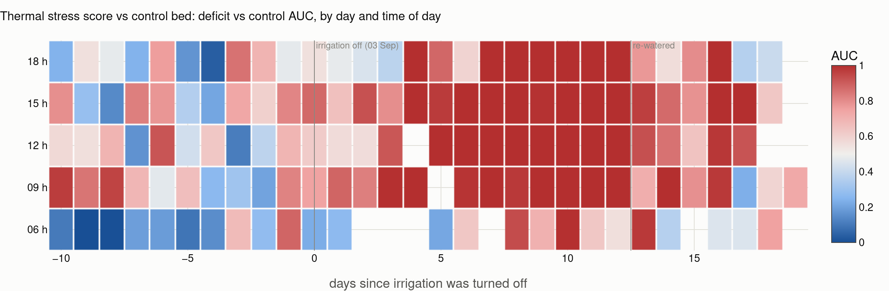

# Result card: daily rhythm and irrigation timing (Yuming)

Data: thermal camera for 39 plants (13 watered controls, 17 in W2, 9 in W3),
24 Aug – 22 Sep 2025, all five daily runs (5,402 plant scans), plus the
greenhouse air and light sensors. Day 0 = 3 Sep, when irrigation of W2 and W3
stopped.

## Three numbers

1. **Day 4.** One thermal flyover a day at 09 h, each plant scored against the
   control bed, flags all **9 of 9** held-out stressed plants (W3) by **day 4**,
   with **0 of 9** false alerts on held-out watered plants and **0 of 18** before
   the cutoff. The paper's set-up (one 15 h flyover, leaf minus air
   temperature) needs until **day 8** (median) at the same false-alert level.
2. **No control bed needed.** Scoring each plant against a healthy-plant line
   (leaf minus air temperature as a function of VPD, from air temperature and
   humidity only) does as well: **9 of 9** W3 plants by **day 4**, no false
   alerts. It needs all five daily flyovers to get there.
3. **Time of day matters more than flyover count.** Stressed and watered plants
   separate (AUC ≥ 0.9 on two days running) from **day 3 at 09 h**, day 4 at
   15 h, day 5 at 12 h and day 7 at 18 h. **The 06 h run never separates
   them**: before dawn, leaves are not transpiring, so they are not cooler
   than a stressed leaf.

## Figure



Each cell: how well the thermal score separates deficit from control plants
(AUC; 0.5 = no difference, 1 = perfect). Red appears first in the 09 h and
15 h rows.

## Two limits

1. **One control bed.** Before the cutoff, when every plant was watered, the
   beds already differ at 06 h (AUC 0.26) and 09 h (0.62), so part of the 09 h
   signal may be a bed difference rather than stress. 15 h is cleaner (0.56)
   and flags W3 by day 3 at a lower threshold. Thresholds were tuned on W2
   with only 4 control plants; W3 and the other 9 controls were never used for
   tuning.
2. **No counterfactual irrigation.** The greenhouse watered on a fixed
   schedule and the soil sensors are unusable, so the results say *when* a
   rule would have fired, not how much water it would save. The
   "demand since last watering" rule fires on day 1 only because it knows
   irrigation stopped; it is a reference, not a stress detector.

Pending: lead time against each plant's leaf-clip onset, once Sam's
`truth/plants` table (column `truth_clip_onset_date`) is pushed. The
`schedules` table fills it in automatically on the next run.

## Reproduce

```bash
export UIWUE_DATA=/path/to/ada2025/data     # raw thermal + environmental files
python -m uiwue.env
python -m uiwue.thermal
python -m uiwue.diurnal                      # prints the checks and the schedule table
```

Pages: Daily rhythm and Irrigation advisor (`cd app && python app.py`).
